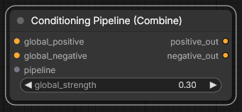
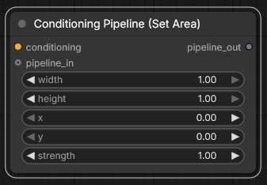
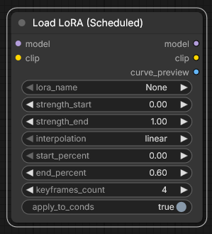
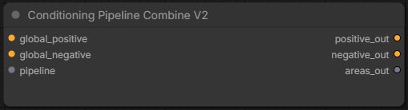
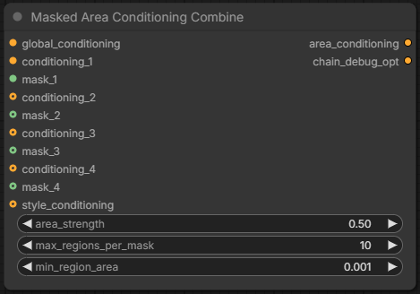
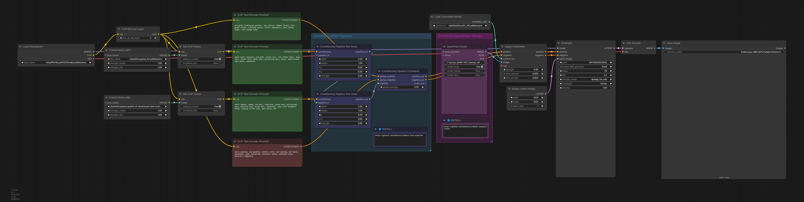
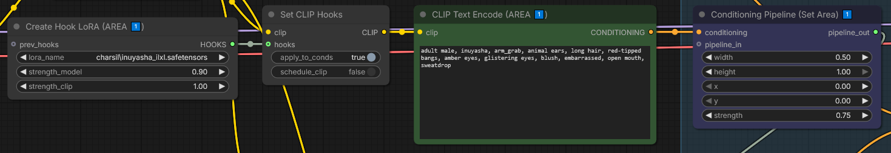
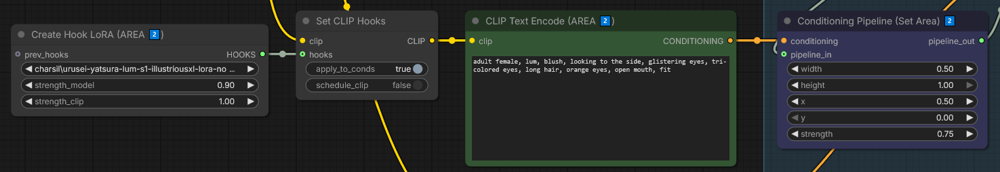
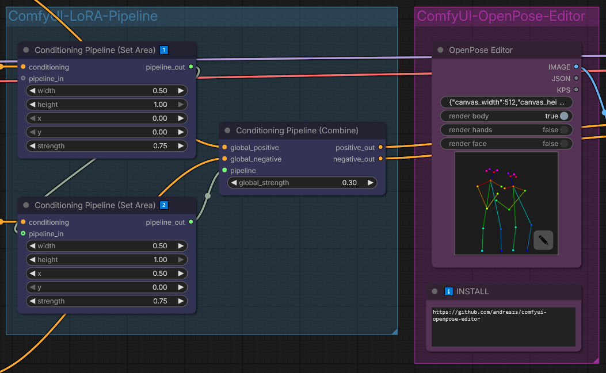

<h4 align="center">
  <a href="./README.md">English</a> | Deutsch | <a href="./README.es.md">Español</a> | <a href="./README.fr.md">Français</a> | <a href="./README.pt.md">Português</a> | <a href="./README.ru.md">Русский</a> | <a href="./README.ja.md">日本語</a> | <a href="./README.ko.md">한국어</a> | <a href="./README.zh.md">中文</a> | <a href="./README.zh-TW.md">繁體中文</a>
</h4>


<p align="center">
  
  
  
</p>
<br />

# ComfyUI LoRA Pipeline

Bereichsbasierte LoRA Konditionierungs-Wrapper und LoRA Planungsknoten für ComfyUI.

---

## Inhaltsverzeichnis

- ✨ [Funktionen](#features)
- 📦 [Installation](#installation)
- ✅ [Empfohlene Einrichtung (mehrere Bereiche / mehrere Themen)](#recommended-setup-multi-area--multi-subject)
- 🔧 [Knoten](#nodes)
  - [Conditioning Pipeline (Set Area)](#conditioning-pipeline-set-area)
  - [Conditioning Pipeline (Combine)](#conditioning-pipeline-combine)
  - [Conditioning Pipeline Combine V2](#conditioning-pipeline-combine-v2)
  - [Masked Area Conditioning Combine](#masked-area-conditioning-combine)
  - [ScheduledLoRALoader](#scheduledloraloader)
- 🧩 [Optionale Abhängigkeiten](#optional-dependencies)
- 🧭 [Mehrbereich-Beispielworkflow](#example-workflow-multi-area-conditioning-pipeline)
- 🖼️ [Galerie](#gallery)
- 💙 [Finanzierung & Unterstützung](#funding--support)
- 📄 [Lizenz](#license)
- 🚀 [Änderungsprotokoll](../CHANGELOG.md)

---

## <a id="features"></a>Funktionen

- Bereichsbasierte Konditionierungspipeline für Eingabeaufforderungen für mehrere Themen und Regionen.
- Ein V2-Kombinationspfad, der den vollständigen globalen Prompt-Kontext in jeder Region ohne konfigurierbare globale Stärke beibehält.
- Maskengesteuerte regionale Konditionierung für Workflows, die bereits Subjekt- oder Zonenmasken bereitstellen.
- Ein-Knoten-gesteuerte LoRA-Stärkesteuerung mit einer Kurvenvorschau-Ausgabe.
- Für eine konsistente Komposition mit mehreren Themen über mehrere Bereiche hinweg wird **ControlNet + OpenPose dringend empfohlen** über [comfyui-openpose-studio](https://github.com/andreszs/comfyui-openpose-studio).
- Ohne ControlNet/OpenPose ist die Komposition mit mehreren Themen und mehreren Bereichen oft inkonsistent und erfordert möglicherweise viele Wiederholungsversuche.
- Nur Python: Keine JavaScript- oder Frontend-Abhängigkeiten erforderlich.

---

## <a id="installation"></a>Installation

### Anforderungen
- ComfyUI (aktueller Build)
- Python 3.10+
- Installierte Abhängigkeit: `scipy`
- Optionale Abhängigkeiten pro Knoten: `matplotlib`

### Schritte

1. Klonen Sie dieses Repository in `ComfyUI/custom_nodes/`.
2. Starten Sie ComfyUI neu.
3. Bestätigen Sie, dass Knoten unter `LoRA Pipeline/` angezeigt werden.

---

## <a id="recommended-setup-multi-area--multi-subject"></a>Empfohlenes Setup (Mehrbereich / Mehrsubjekt)

- Verwenden Sie ControlNet OpenPose (empfohlen): [comfyui-openpose-studio](https://github.com/andreszs/comfyui-openpose-studio).
- Halten Sie die globale Eingabeaufforderung minimal und allgemein.
- Halten Sie `global_strength` niedrig (Faustregel: unter `0.5`).
- Balance pro Bereich Stärke, `global_strength` und LoRA Stärke; Maximieren Sie nicht alle Stärken.
- Beispielhafte Grundwerte, die gut funktioniert haben: Flächenstärken um `0.75`, LoRA Stärken um `0.90`.

---

## <a id="nodes"></a>Knoten

| Conditioning Pipeline (Combine) | Conditioning Pipeline (Set Area) | Load LoRA (Scheduled) |
|---|---|---|
|  |  |  |

### <a id="conditioning-pipeline-set-area"></a>Conditioning Pipeline (Set Area)

Definieren Sie jeweils einen bereichsbedingten Eintrag. Dieser Knoten definiert einen rechteckigen Bereich mit Breite, Höhe, x und y und wendet dann als Teil einer verketteten Konditionierungspipeline eine spezielle Konditionierungsaufforderung und -stärke auf diesen Bereich an.

**Auf einen Blick:**
- Verwenden Sie eine Knoteninstanz pro Region/Betreff-Eingabeaufforderung.
- Verketten Sie mehrere Instanzen, um eine regionale Konditionierungspipeline aufzubauen.
- Ermöglicht eine saubere Mehrsubjektkontrolle vor der endgültigen Kombination.

**Eingaben:**
- `conditioning` (`CONDITIONING`, erforderlich)
- `width`, `height`, `x`, `y` (`FLOAT`, normalisiert `0.0-1.0`)
- `strength` (`FLOAT`, Standard `1.0`)
- `pipeline_in` (`CONDITIONING_PIPELINE`, optional)

**Ausgaben:**
- `pipeline_out` (`CONDITIONING_PIPELINE`)

**Hinweise zum Verhalten:**
- Erstellt eine neue Pipeline, wenn `pipeline_in` nicht verbunden ist.
- Fügt einen neuen regionalen Eintrag hinzu, wenn `pipeline_in` verbunden ist.
- Hält die Einträge geordnet, sodass Sie vorhersehbare regionale Stapel aufbauen können.
- Niedrigere Bereichsstärken verbessern häufig die Gesamtbildqualität, verringern jedoch die Kontrollbefugnis pro Bereich.
- Balancieren Sie die Flächenstärke zusammen mit global_strength und der LoRA-Stärke in Create Hook Lora.

**Häufige Fehler:**
- Bereitstellung von Pixelkoordinaten anstelle normalisierter `0.0-1.0`-Werte.
- `width`/`height` in die Nähe von `0` setzen und sichtbare Wirkung erwarten.
- Vergessen, die letzte Pipeline an `Conditioning Pipeline (Combine)` zu übergeben.

---

### <a id="conditioning-pipeline-combine"></a>Conditioning Pipeline (Combine)

Kombinieren Sie globale positive/negative Konditionierung mit der Bereichspipeline für regionalbezogene Ergebnisse. Zusammen mit Set Area ist dies der Kernpfad für Multi-LoRAs und separate Konditionierungen pro Subjekt/Zone.

**Auf einen Blick:**
- Wandelt Ihre regionale Pipeline in endgültige positive/negative Ergebnisse um.
- Behält den globalen Eingabeaufforderungskontext bei und fügt gleichzeitig lokale regionale Kontrolle hinzu.

**Eingaben:**
- `global_positive` (`CONDITIONING`, erforderlich)
- `global_negative` (`CONDITIONING`, erforderlich)
- `pipeline` (`CONDITIONING_PIPELINE`, erforderlich)
- `global_strength` (`FLOAT`, Standard `0.3`)

**Ausgaben:**
- `positive_out` (`CONDITIONING`)
- `negative_out` (`CONDITIONING`)
- `areas_out` (`CONDITIONING_AREAS`)

**Details zu `areas_out`:**

`areas_out` gibt die Liste der konfigurierten Bereichsregionen als strukturierte Datenausgabe aus. Jeder Eintrag enthält die normalisierten Koordinaten (`x`, `y`, `width`, `height`) und `strength`, die über `Conditioning Pipeline (Set Area)` in der Pipeline definiert wurden. Verbinden Sie `areas_out` mit [ComfyUI-OpenPose-Studio](https://github.com/andreszs/comfyui-openpose-studio), um Ihre Konditionierungsbereiche automatisch in den OpenPose-Editor zu spiegeln — die Pose-Platzierung wird sich an den genau konditionierten Regionen ausrichten. Dieser Ausgang kann auch von anderen Erweiterungen oder Knoten verwendet werden, die Bereichsmetadaten für die Maskengenerierung oder bereichsbewusste nachgelagerte Verarbeitung akzeptieren.

**Hinweise zum Verhalten:**
- Wenn die Pipeline leer/ungültig ist, greifen die Ausgaben auf die globalen Eingaben zurück, und `areas_out` ist eine leere Liste.
- Wendet regionale Einträge an und anschließend einen Standard-Kombinationsdurchgang für nicht abgedeckte Regionen.
- `global_strength` steuert, wie stark der globale Kontext mit lokalen Bereichen konkurriert.
- Wenn Sie global_strength zu hoch einstellen, kann dies den Einfluss der bereichsspezifischen Konditionierung verringern und sich negativ auf die Bildqualität auswirken.
- Gute Ergebnisse werden im Allgemeinen dadurch erzielt, dass die globale Stärke mit der Stärke pro Bereich und der LoRA-Stärke in Einklang gebracht wird, anstatt alle Werte zu maximieren.
- Der optimierte Konditionierungspfad ist immer aktiv. Die globale positive Konditionierung wird an jede regionale positive Konditionierung angehängt, damit bereichsspezifische LoRAs wirksam bleiben; `global_strength` skaliert nur den angehängten globalen Anteil.
- `fast_mode` wurde entfernt, da sein deaktivierter Legacy-Pfad die bereichsspezifische LoRA-Konditionierung umging; ein Beibehalten des Schalters hätte weiterhin einen bekanntermaßen fehlerhaften regionalen Pfad angeboten.
- Wenn die konfigurierten Regionen die gesamte Leinwand abdecken, vermeidet der Knoten einen separaten globalen positiven Durchgang. Bei unvollständiger Abdeckung bleibt der globale Fallback aus Korrektheitsgründen erhalten, daher fällt die Beschleunigung geringer aus.

**Häufige Fehler:**
- Es wird nur ein Konditionierungsstrom zugeführt, statt sowohl positiv als auch negativ.
- Übersteuerung von `global_strength` und Auswaschen von Bereichsdetails.
- Erstellen Sie Bereichseinträge, vergessen Sie jedoch, die kombinierten Ausgänge mit Ihrem Sampler-Pfad zu verbinden.

---

### <a id="conditioning-pipeline-combine-v2"></a>Conditioning Pipeline Combine V2

Kombiniert dieselbe verkettete rechteckige Bereichspipeline mit dem globalen positiven Kontext in voller Stärke in jedem regionalen Prompt. V2 entfernt die Steuerung `global_strength` und hält die globale positive Konditionierung in jeder Region stets verfügbar, während die globale negative Konditionierung und die Bereichsmetadaten-Ausgabe erhalten bleiben.



**Auf einen Blick:**
- Verwendet dieselbe Kette aus `Conditioning Pipeline (Set Area)` wie der ursprüngliche Combine-Knoten.
- Hängt die vollständige globale positive Konditionierung an jede gültige regionale Konditionierung an.
- Behält einen dynamischen globalen Standardwert für Pixel außerhalb der konfigurierten Regionen bei.
- Stellt die konfigurierte Bereichsliste für OpenPose Studio und andere regionsbewusste Knoten bereit.

**Eingänge:**
- `global_positive` (`CONDITIONING`, erforderlich)
- `global_negative` (`CONDITIONING`, erforderlich)
- `pipeline` (`CONDITIONING_PIPELINE`, erforderlich)

**Ausgänge:**
- `positive_out` (`CONDITIONING`)
- `negative_out` (`CONDITIONING`)
- `areas_out` (`CONDITIONING_AREAS`)

**Verhaltenshinweise:**
- Ist die Pipeline leer oder ungültig, gibt der Knoten die globale positive und negative Konditionierung mit einer leeren Bereichsliste zurück.
- Jeder regionale Prompt erhält den vollständigen globalen positiven Kontext; es gibt keine globale Stärkeeinstellung pro Knoten.
- Die globale positive Konditionierung bleibt auch als Standard-Fallback für nicht abgedeckte Pixel erhalten.
- Die regionalen `strength`-Werte jedes Set-Area-Knotens steuern weiterhin ihre jeweiligen Masken.

**Häufige Fehler:**
- Einen `global_strength`-Eingang zu erwarten; V2 stellt diesen absichtlich nicht bereit.
- Den globalen positiven Prompt wegzulassen und sich nur auf regionale Prompts zu verlassen.
- Die letzte Set-Area-Pipeline nicht mit `pipeline` zu verbinden.

---

### <a id="masked-area-conditioning-combine"></a>Masked Area Conditioning Combine

Erstellt regionale Konditionierung direkt aus Masken anstelle normalisierter Rechteckkoordinaten. Verwenden Sie diesen Knoten, wenn ein anderer Teil des Workflows bereits Masken für Subjekte oder Zonen erzeugt, die separate Prompts oder LoRAs benötigen.



**Auf einen Blick:**
- Akzeptiert bis zu vier Konditionierungs-/Maskenpaare.
- Erkennt und filtert zusammenhängende Regionen innerhalb jeder Maske.
- Hängt globalen und optionalen Stilkontext an jede regionale Konditionierung an.
- Verwendet dieselbe optimierte Vollbild-Konditionierungsstrategie wie `Conditioning Pipeline (Combine)`.

**Eingänge:**
- `global_conditioning` (`CONDITIONING`, erforderlich)
- `conditioning_1` (`CONDITIONING`, erforderlich)
- `mask_1` (`MASK`, erforderlich)
- `area_strength` (`FLOAT`, Standard `0.5`)
- `conditioning_2` bis `conditioning_4` (`CONDITIONING`, optional)
- `mask_2` bis `mask_4` (`MASK`, optional)
- `style_conditioning` (`CONDITIONING`, optional)
- `max_regions_per_mask` (`INT`, Standard `10`)
- `min_region_area` (`FLOAT`, Standard `0.001`)

**Ausgänge:**
- `area_conditioning` (`CONDITIONING`)
- `chain_debug_opt` (`CONDITIONING`)

**Verhaltenshinweise:**
- Jede optionale Konditionierung muss eine passende Maske besitzen; unvollständige Paare werden ignoriert.
- Zusammenhängende Komponenten kleiner als `min_region_area` werden ignoriert. Enthält eine Maske mehr Komponenten als `max_regions_per_mask`, bleiben nur die größten erhalten.
- `area_strength` wird gleichmäßig auf jede akzeptierte Maske angewendet.
- Decken die akzeptierten Masken nicht die gesamte Leinwand ab, bleibt die globale/Stil-Konditionierung als Fallback für nicht abgedeckte Pixel erhalten.
- Bleiben nach der Filterung keine gültigen Regionen übrig, geben beide Ausgänge die globale Konditionierung zurück.

**Häufige Fehler:**
- Eine optionale Konditionierung ohne passende Maske zu verbinden oder umgekehrt.
- `min_region_area` so hoch einzustellen, dass die gewünschten Subjekte herausgefiltert werden.
- Nicht-binäre Masken zu senden und zu erwarten, dass Werte von `0.5` oder darunter eingeschlossen werden.

---

### <a id="scheduledloraloader"></a>ScheduledLoRALoader

Tragen Sie einen LoRA mit konstanter Stärke oder einer geplanten Kurve über den Diffusionsfortschritt in einem sauberen Knoten auf.

**Auf einen Blick:**
- Ersetzt chaotische Ketten mehrerer nativer LoRA/Kontrollknoten.
- Hält Timing, Interpolation und Vorschau zusammen.
- Sauberere Diagrammverkabelung für zeitliches LoRA-Verhalten.

**Eingaben:**
- `model` (`MODEL`, erforderlich)
- `clip` (`CLIP`, erforderlich)
- `lora_name` (`STRING`, erforderlich)
- `strength_start`, `strength_end` (`FLOAT`)
- `interpolation` (`STRING`: `linear`, `ease_in`, `ease_out`, `ease_in_out`)
- `start_percent`, `end_percent` (`FLOAT`, `0.0-1.0`)
- `keyframes_count` (`INT`, Standard `4`)
- `apply_to_conds` (`BOOLEAN`, optional)

**Ausgaben:**
- `model` (`MODEL`)
- `clip` (`CLIP`)
- `curve_preview` (`IMAGE`)

**Hinweise zum Verhalten:**
- Wenn `lora_name` `None` ist, wird das Modell/der Clip durchlaufen und die Vorschau wird weiterhin gerendert.
- Wenn Start- und Endstärke übereinstimmen, verhält es sich wie eine konstante LoRA-Anwendung.
- Mithilfe der Kurvenvorschau können Sie das Timing vor dem vollständigen Rendern schnell überprüfen.

**Häufige Fehler:**
- `matplotlib` vergessen, wenn `curve_preview` verwendet wird.
- Verwendung eines Zeitplanfensters, das nicht mit der Timing-Absicht des Samplers übereinstimmt.
- Es wird erwartet, dass dieser Knoten `CONDITIONING` direkt ausgibt.

---

## <a id="optional-dependencies"></a>Optionale Abhängigkeiten

Installieren Sie nur das, was Sie benötigen, in derselben Python-Umgebung, die von ComfyUI verwendet wird.

- `ScheduledLoRALoader` Kurvenvorschau: `python -m pip install matplotlib`

---

## <a id="example-workflow-multi-area-conditioning-pipeline"></a>Mehrbereich-Beispielworkflow

[](../workflows/conditioninig_pipeline_area_wf.png)

Sie können dieses Workflow-Bild per Drag & Drop in ComfyUI ziehen, um das vollständige Diagramm zu importieren/laden.

#### Einrichtung von Bereich 1

[](../assets/conditioninig_area_1.png)

- Verwenden Sie natives `Create Hook Lora`, um ein LoRA zu laden und die Bereichsaufforderung/-konditionierung für Bereich 1 zu definieren.
- Verbinden Sie diese Konditionierung mit `Conditioning Pipeline (Set Area)` und legen Sie `width`, `height`, `x`, `y` und `strength` für diese Region fest.

#### Einrichtung von Bereich 2

[](../assets/conditioninig_area_2.png)

- Wiederholen Sie genau das gleiche Muster: ein weiterer `Create Hook Lora` + ein weiterer `Conditioning Pipeline (Set Area)`.
- Sie können dieses Muster für weitere Bereiche wiederholen.

#### Pipeline-Verkettung und Kombination

[](../assets/conditioning_combine.png)

- Verketten Sie `pipeline_out` von Bereich 1 in Bereich 2 (verkettete Pipeline-Einträge).
- Senden Sie `pipeline_out` vom letzten Bereich an `Conditioning Pipeline (Combine)`, wodurch die Bereichspipeline mit der globalen Konditionierung zusammengeführt wird.
- Leiten Sie die kombinierte Ausgabe direkt an `KSampler` oder an `ControlNet` weiter. In diesem Beispiel wird es an `ControlNet` weitergeleitet.

#### OpenPose / ControlNet Anleitung

- OpenPose/ControlNet ist im Allgemeinen optional, wird jedoch für diesen speziellen Kompositionsworkflow mit mehreren Themen und mehreren Bereichen für eine konsistente Komposition dringend empfohlen.
- Siehe [comfyui-openpose-studio](https://github.com/andreszs/comfyui-openpose-studio) vom selben Autor (neueres Repository).

#### Globale `Styler Pipeline`-Platzierung

[](../assets/styler_pipeline_node.png)

Globales Styling bedeutet, dass `Styler Pipeline` zusätzlich zur bereichsbezogenen Konditionierung (oder anstelle dieser) einmal auf das gesamte Bild angewendet wird.

- Allgemeine Regel: Verbinden Sie `Styler Pipeline` vor `KSampler`.
- Bei Verwendung von ControlNet kann `Styler Pipeline` entweder vor der Anwendung von ControlNet oder nach der Anwendung von ControlNet verbunden werden.
- In der Praxis ist das Ergebnis in der Regel gleichwertig. Wählen Sie daher die Platzierung, die in Ihrem Diagramm bequemer ist.

#### `global_strength` Kompromisse

- Eine zu starke Erhöhung von `global_strength` verringert den relativen Einfluss der Konditionierungen pro Bereich und kann die Identität von LoRA/Stil pro Bereich schwächen.
- Eine höhere globale Stärke kann sich auch negativ auf die Bildqualität auswirken.
- Halten Sie `global_strength` niedrig und halten Sie die globale Eingabeaufforderung minimal/allgemein.
- Faustregel: Verwenden Sie im Allgemeinen Werte unter `0.5` (getestet bis `0.5`) und verlassen Sie sich nicht auf globale Konditionierungen, die über allgemeine Richtlinien hinausgehen.
- Eine Verringerung der LoRA-Stärke verringert tendenziell die LoRA-Identität oder die Charaktertreue, während eine Verringerung der Bereichsstärke tendenziell die Kontrolle pro Bereich verringert.
- Es wird nicht empfohlen, alles zu maximieren, da hohe kombinierte Stärken die Bildqualität beeinträchtigen können. Dies gilt insbesondere dann, wenn LoRAs von verschiedenen Autoren gemischt werden, was zu inkonsistenter Qualität führen kann.
- Faustregel für LoRAs mit mehreren Zeichen: Verwenden Sie nach Möglichkeit LoRAs desselben Autors oder einen ähnlichen Trainingsansatz, um konsistentere kombinierte Ergebnisse zu erzielen.

---

## <a id="gallery"></a>Galerie

| Vorschau | Beschreibung |
|---------|-------------|
| [](../workflows/winter_spring_landscape_v2.png) | **Conditioning Pipeline V2 — Winter-/Frühlingslandschaft**<br><br>Zeigt eine einzige zusammenhängende Landschaft, die links als Winter und rechts als Frühling konditioniert ist, ohne ControlNet.<br><br>Ziehen Sie dieses PNG in ComfyUI oder öffnen Sie es dort, um den vollständigen in den Bildmetadaten eingebetteten Workflow zu laden. Eine eigenständige [Workflow-JSON](../workflows/winter_spring_landscape_v2.json) ist ebenfalls enthalten. |
| [](../workflows/conditioninig_pipeline_area.png) | **Conditioning Pipeline V2 — mehrere Bereiche mit ControlNet OpenPose**<br><br>Zeigt mehrere vertikale Bereiche mit getrennten Charakter-LoRAs und ohne LoRA-Bleeding unter Verwendung von ControlNet OpenPose.<br><br>Ziehen Sie dieses PNG in ComfyUI oder öffnen Sie es dort, um den vollständigen eingebetteten V2-Workflow zu laden.<br><br>Erfordert [comfyui-openpose-studio](https://github.com/andreszs/comfyui-openpose-studio). |
| [](../workflows/conditioninig_pipeline_styled.png) | **Conditioning Pipeline V2 — selektives Bereichs-Styling mit ControlNet**<br><br>Zeigt selektives Styling pro Bereich: Inuyasha verwendet links die ursprüngliche ungestylte Konditionierung, während Styler Pipeline nur auf Ayame rechts Space Opera Anime, Space Marine Armor und Neon-Blue-Beleuchtung anwendet.<br><br>Ziehen Sie dieses PNG in ComfyUI oder öffnen Sie es dort, um den vollständigen eingebetteten V2-Workflow zu laden.<br><br>Erfordert [comfyui-openpose-studio](https://github.com/andreszs/comfyui-openpose-studio) und [comfyui-styler-pipeline](https://github.com/andreszs/comfyui-styler-pipeline).<br><br>Ein Styler-Knoten kann nur in die Bereiche eingefügt werden, die ihn benötigen, während andere Bereiche direkt mit Conditioning Pipeline Set Area verbunden werden. Globales Styling ist auch möglich, indem der Styler-Knoten direkt vor ControlNet verbunden wird. |

In [diesem Beitrag](https://www.andreszsogon.com/building-a-multi-character-comfyui-workflow-with-area-conditioning-openpose-control-and-style-layering/) findest du ein vollständiges Workflow, das mehrere Conditioning-Bereiche, OpenPose, ControlNet und Styler gleichzeitig kombiniert.

---

## <a id="funding--support"></a>Finanzierung und Unterstützung

### Warum Ihre Unterstützung wichtig ist

Dieses Plugin wird unabhängig entwickelt und gepflegt, wobei regelmäßig **kostenpflichtige KI-Agenten** eingesetzt werden, um Debugging, Tests und Verbesserungen der Lebensqualität zu beschleunigen. Wenn Sie es sinnvoll finden, trägt finanzielle Unterstützung dazu bei, dass die Entwicklung stetig voranschreitet.

Ihr Beitrag hilft:

* Finanzieren Sie KI-Tools für schnellere Korrekturen und neue Funktionen
* Decken Sie laufende Wartungs- und Kompatibilitätsarbeiten für ComfyUI-Updates ab
* Verhindern Sie Entwicklungsverlangsamungen, wenn die Nutzungsgrenzen erreicht sind

> [!TIP]
> Nicht spenden? Ein GitHub-Star ⭐ hilft immer noch sehr, indem er die Sichtbarkeit verbessert und mehr Benutzern hilft

### 💙 Unterstützen Sie dieses Projekt

<table style="width: 100%; table-layout: fixed;">
  <tr>
    <td align="center" style="width: 33.33%; padding: 20px;">
      <div>
        <h4 style="margin: 8px 0;">Ko-fi</h4>
        <a href="https://ko-fi.com/D1D716OLPM" target="_blank" rel="noopener noreferrer">
          
        </a>
        <p style="margin: 8px 0; font-size: 12px;"><a href="https://ko-fi.com/D1D716OLPM" target="_blank" rel="noopener noreferrer">Kaufe einen Kaffee</a></p>
      </div>
    </td>
    <td align="center" style="width: 33.33%; padding: 20px;">
      <div>
        <h4 style="margin: 8px 0;">PayPal</h4>
        <a href="https://www.paypal.com/ncp/payment/GEEM324PDD9NC" target="_blank" rel="noopener noreferrer">
          
        </a>
        <p style="margin: 8px 0; font-size: 12px;"><a href="https://www.paypal.com/ncp/payment/GEEM324PDD9NC" target="_blank" rel="noopener noreferrer">PayPal öffnen</a></p>
      </div>
    </td>
    <td align="center" style="width: 33.33%; padding: 20px;">
      <div>
        <h4 style="margin: 8px 0;">USDC (nur Arbitrum)</h4>
        <a href="https://arbiscan.io/address/0xe36a336fC6cc9Daae657b4A380dA492AB9601e73" target="_blank" rel="noopener noreferrer">
          
        </a>
        <p style="margin: 8px 0; font-size: 12px;"><a href="#usdc-address">Adresse anzeigen</a></p>
      </div>
    </td>
  </tr>
</table>

<a id="usdc-address"></a>
<details>
  <summary>USDC-Adresse anzeigen</summary>

```text
0xe36a336fC6cc9Daae657b4A380dA492AB9601e73
```

> [!WARNING]
> Senden Sie USDC ausschließlich über Arbitrum One. Überweisungen über jedes andere Netzwerk kommen nicht an und können dauerhaft verloren gehen.
</details>

## <a id="license"></a>Lizenz

MIT-Lizenz – siehe [LICENSE](../LICENSE) für den vollständigen Text.

---

**Verwaltet von:** andreszs
**Status:** Aktive Entwicklung

---
