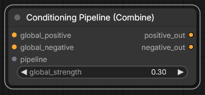
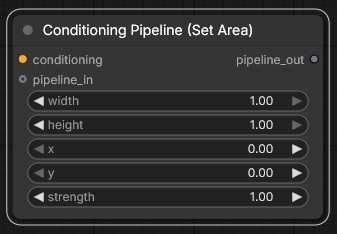
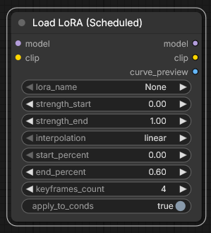
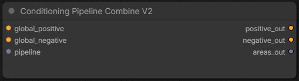
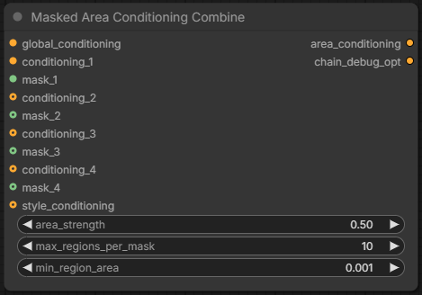
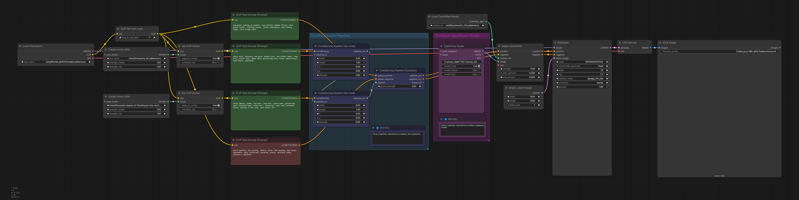
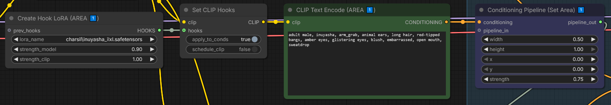
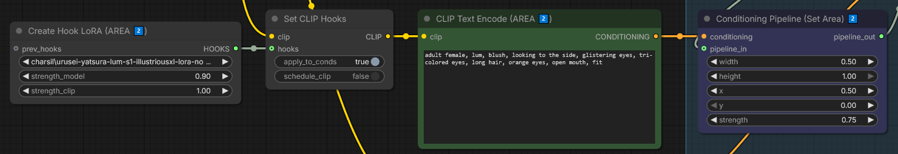
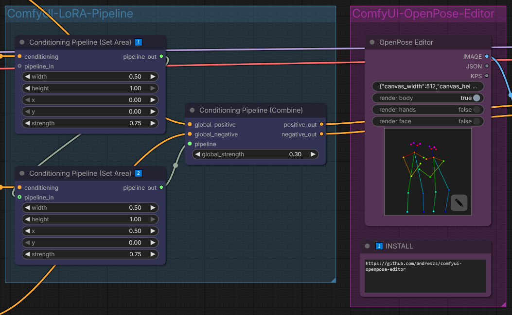

<h4 align="center">
  <a href="./README.md">English</a> | <a href="./README.de.md">Deutsch</a> | Español | <a href="./README.fr.md">Français</a> | <a href="./README.pt.md">Português</a> | <a href="./README.ru.md">Русский</a> | <a href="./README.ja.md">日本語</a> | <a href="./README.ko.md">한국어</a> | <a href="./README.zh.md">中文</a> | <a href="./README.zh-TW.md">繁體中文</a>
</h4>


<p align="center">
  
  
  
</p>
<br />

# ComfyUI LoRA Pipeline

Wrappers de condicionamiento LoRA basados en áreas y nodos de planificación LoRA para ComfyUI.

---

## Tabla de contenido

- ✨ [Características](#features)
- 📦 [Instalación](#installation)
- ✅ [Configuración recomendada (multiárea/multitema)](#recommended-setup-multi-area--multi-subject)
- 🔧 [Nodos](#nodes)
  - [Conditioning Pipeline (Set Area)](#conditioning-pipeline-set-area)
  - [Conditioning Pipeline (Combine)](#conditioning-pipeline-combine)
  - [Conditioning Pipeline Combine V2](#conditioning-pipeline-combine-v2)
  - [Masked Area Conditioning Combine](#masked-area-conditioning-combine)
  - [ScheduledLoRALoader](#scheduledloraloader)
- 🧩 [Dependencias opcionales](#optional-dependencies)
- 🧭 [Workflow de ejemplo con múltiples áreas](#example-workflow-multi-area-conditioning-pipeline)
- 🖼️ [Galería](#gallery)
- 💙 [Financiamiento y apoyo](#funding--support)
- 📄 [Licencia](#license)
- 🚀 [Registro de cambios](../CHANGELOG.md)

---

## <a id="features"></a>Características

- Canal de acondicionamiento basado en áreas para indicaciones de múltiples sujetos y múltiples regiones.
- Una ruta de combinación V2 que conserva todo el contexto del prompt global en cada región, sin una entrada configurable de fuerza global.
- Acondicionamiento regional basado en máscaras para workflows que ya proporcionan máscaras de sujetos o zonas.
- Control de fuerza LoRA programado de un nodo con una salida de vista previa de curva.
- Para una composición consistente de múltiples temas en múltiples áreas, se recomienda encarecidamente **ControlNet + OpenPose** a través de [comfyui-openpose-studio](https://github.com/andreszs/comfyui-openpose-studio).
- Sin ControlNet/OpenPose, la composición de múltiples sujetos y múltiples áreas suele ser inconsistente y puede requerir muchos reintentos.
- Solo Python: no se requieren JavaScript ni dependencias de interfaz.

---

## <a id="installation"></a>Instalación

### Requisitos
- ComfyUI (construcción reciente)
- Python 3.10+
- Dependencia instalada: `scipy`
- Dependencias opcionales por nodo: `matplotlib`

### Pasos

1. Clona este repositorio en `ComfyUI/custom_nodes/`.
2. Reinicie ComfyUI.
3. Confirme que los nodos aparecen en `LoRA Pipeline/`.

---

## <a id="recommended-setup-multi-area--multi-subject"></a>Configuración recomendada (multiárea/multitema)

- Utilice ControlNet OpenPose (recomendado): [comfyui-openpose-studio](https://github.com/andreszs/comfyui-openpose-studio).
- Mantenga el aviso global mínimo y general.
- Mantenga `global_strength` bajo (regla general: por debajo de `0.5`).
- Equilibre la fuerza por área, `global_strength` y LoRA; no maximices todas las fortalezas.
- Ejemplos de valores de referencia que funcionaron bien: fortalezas del área alrededor de `0.75`, fortalezas LoRA alrededor de `0.90`.

---

## <a id="nodes"></a>Nodos

| Conditioning Pipeline (Combine) | Conditioning Pipeline (Set Area) | Load LoRA (Scheduled) |
|---|---|---|
|  |  |  |

### <a id="conditioning-pipeline-set-area"></a>Conditioning Pipeline (Set Area)

Defina una entrada condicionada por área a la vez. Este nodo define una región rectangular con ancho, alto, x e y, luego aplica un mensaje de acondicionamiento dedicado y una fuerza a esa región como parte de un proceso de acondicionamiento encadenado.

**De un vistazo:**
- Utilice una instancia de nodo por mensaje de región/tema.
- Encadene múltiples instancias para construir un canal de acondicionamiento regional.
- Permite un control limpio de múltiples sujetos antes de la combinación final.

**Entradas:**
- `conditioning` (`CONDITIONING`, requerido)
- `width`, `height`, `x`, `y` (`FLOAT`, `0.0-1.0` normalizado)
- `strength` (`FLOAT`, predeterminado `1.0`)
- `pipeline_in` (`CONDITIONING_PIPELINE`, opcional)

**Salidas:**
- `pipeline_out` (`CONDITIONING_PIPELINE`)

**Notas de comportamiento:**
- Crea una nueva canalización si `pipeline_in` no está conectado.
- Agrega una nueva entrada regional cuando `pipeline_in` está conectado.
- Mantiene las entradas ordenadas para que puedas crear pilas regionales predecibles.
- Las fortalezas de área más bajas a menudo mejoran la calidad general de la imagen, pero reducen la autoridad de control por área.
- Equilibre la fuerza del área junto con global_strength y la fuerza LoRA en Create Hook Lora.

**Errores comunes:**
- Proporcionar coordenadas de píxeles en lugar de valores `0.0-1.0` normalizados.
- Estableciendo `width`/`height` cerca de `0` y esperando un efecto visible.
- Olvidar pasar el pipeline final a `Conditioning Pipeline (Combine)`.

---

### <a id="conditioning-pipeline-combine"></a>Conditioning Pipeline (Combine)

Combinar el condicionamiento global positivo/negativo con el pipeline del área para obtener resultados conscientes de la región. Junto con Set Area, esta es la ruta principal para múltiples LoRA y condicionamientos separados por sujeto/zona.

**De un vistazo:**
- Convierte tu pipeline regional en salidas finales positivas/negativas.
- Mantiene el contexto del prompt global mientras agrega control regional local.

**Entradas:**
- `global_positive` (`CONDITIONING`, requerido)
- `global_negative` (`CONDITIONING`, requerido)
- `pipeline` (`CONDITIONING_PIPELINE`, requerido)
- `global_strength` (`FLOAT`, predeterminado `0.3`)

**Salidas:**
- `positive_out` (`CONDITIONING`)
- `negative_out` (`CONDITIONING`)
- `areas_out` (`CONDITIONING_AREAS`)

**Detalles de `areas_out`:**

`areas_out` expone la lista de regiones de área configuradas como una salida de datos estructurada. Cada entrada contiene las coordenadas normalizadas (`x`, `y`, `width`, `height`) y `strength` que se definieron en la canalización mediante `Conditioning Pipeline (Set Area)`. Conecte `areas_out` a [ComfyUI-OpenPose-Studio](https://github.com/andreszs/comfyui-openpose-studio) para reflejar automáticamente sus áreas de condicionamiento en el editor de OpenPose — la colocación de poses se alineará con las regiones exactas que condicionó. Esta salida también puede ser consumida por cualquier otra extensión o nodo que acepte metadatos de área para generación de máscaras o procesamiento posterior consciente de regiones.

**Notas de comportamiento:**
- Si la canalización está vacía o no es válida, las salidas vuelven a las entradas globales y `areas_out` es una lista vacía.
- Aplica entradas regionales, luego un pase combinado predeterminado para regiones no cubiertas.
- `global_strength` controla la fuerza con la que el contexto global compite con las áreas locales.
- Presionar global_strength demasiado alto puede reducir la influencia del acondicionamiento por área y afectar negativamente la calidad de la imagen.
- Los buenos resultados generalmente provienen de equilibrar la fuerza global con la fuerza por área y la fuerza LoRA en lugar de maximizar todos los valores.
- La ruta de acondicionamiento optimizada está siempre activa. El acondicionamiento positivo global se concatena en cada acondicionamiento positivo regional para que los LoRA por área sigan siendo efectivos; `global_strength` sólo escala la parte global agregada.
- `fast_mode` se eliminó porque su ruta heredada desactivada omitía el acondicionamiento LoRA por área; conservar el interruptor habría seguido exponiendo una ruta regional incorrecta conocida.
- Cuando las regiones configuradas cubren todo el canvas, el nodo evita un pase positivo global independiente. Si la cobertura es incompleta, se conserva el fallback global por corrección, por lo que la mejora de velocidad será menor.

**Errores comunes:**
- Alimentar solo una corriente condicionante en lugar de positiva y negativa.
- Subir demasiado `global_strength` y perder detalles del área.
- Construya entradas de área pero olvídese de conectar las salidas combinadas a su ruta de muestreo.

---

### <a id="conditioning-pipeline-combine-v2"></a>Conditioning Pipeline Combine V2

Combina el mismo pipeline encadenado de áreas rectangulares con el contexto positivo global a fuerza completa en cada prompt regional. V2 elimina el control `global_strength` y mantiene siempre disponible el acondicionamiento positivo global en cada región, conservando el acondicionamiento negativo global y la salida de metadatos de áreas.



**De un vistazo:**
- Usa la misma cadena `Conditioning Pipeline (Set Area)` que el nodo Combine original.
- Concatena todo el acondicionamiento positivo global en cada acondicionamiento regional válido.
- Mantiene un valor global predeterminado dinámico para los píxeles fuera de las regiones configuradas.
- Expone la lista de áreas configuradas para OpenPose Studio y otros nodos conscientes de regiones.

**Entradas:**
- `global_positive` (`CONDITIONING`, requerido)
- `global_negative` (`CONDITIONING`, requerido)
- `pipeline` (`CONDITIONING_PIPELINE`, requerido)

**Salidas:**
- `positive_out` (`CONDITIONING`)
- `negative_out` (`CONDITIONING`)
- `areas_out` (`CONDITIONING_AREAS`)

**Notas de comportamiento:**
- Si el pipeline está vacío o no es válido, el nodo devuelve los acondicionamientos positivo y negativo globales con una lista de áreas vacía.
- Cada prompt regional recibe todo el contexto positivo global; no existe un ajuste de fuerza global por nodo.
- El acondicionamiento positivo global también se conserva como fallback predeterminado para los píxeles no cubiertos.
- Los valores regionales de `strength` de cada nodo Set Area siguen controlando sus máscaras respectivas.

**Errores comunes:**
- Esperar una entrada `global_strength`; V2 no la expone deliberadamente.
- Omitir el prompt positivo global y depender únicamente de prompts regionales.
- Olvidar conectar el pipeline del último Set Area a `pipeline`.

---

### <a id="masked-area-conditioning-combine"></a>Masked Area Conditioning Combine

Construye acondicionamiento regional directamente desde máscaras en lugar de coordenadas rectangulares normalizadas. Utiliza este nodo cuando otra parte del workflow ya produce máscaras para los sujetos o zonas que necesitan prompts o LoRA separados.



**De un vistazo:**
- Acepta hasta cuatro pares de acondicionamiento y máscara.
- Detecta y filtra regiones conectadas dentro de cada máscara.
- Concatena contexto global y de estilo opcional en cada acondicionamiento regional.
- Usa la misma estrategia optimizada de acondicionamiento de canvas completo que `Conditioning Pipeline (Combine)`.

**Entradas:**
- `global_conditioning` (`CONDITIONING`, requerido)
- `conditioning_1` (`CONDITIONING`, requerido)
- `mask_1` (`MASK`, requerido)
- `area_strength` (`FLOAT`, predeterminado `0.5`)
- `conditioning_2` a `conditioning_4` (`CONDITIONING`, opcional)
- `mask_2` a `mask_4` (`MASK`, opcional)
- `style_conditioning` (`CONDITIONING`, opcional)
- `max_regions_per_mask` (`INT`, predeterminado `10`)
- `min_region_area` (`FLOAT`, predeterminado `0.001`)

**Salidas:**
- `area_conditioning` (`CONDITIONING`)
- `chain_debug_opt` (`CONDITIONING`)

**Notas de comportamiento:**
- Cada acondicionamiento opcional debe tener su máscara correspondiente; los pares incompletos se ignoran.
- Los componentes conectados menores que `min_region_area` se ignoran. Si una máscara contiene más componentes que `max_regions_per_mask`, sólo se conservan los mayores.
- `area_strength` se aplica uniformemente a cada máscara aceptada.
- Si las máscaras aceptadas no cubren todo el canvas, el acondicionamiento global/de estilo se conserva como fallback para los píxeles no cubiertos.
- Si no queda ninguna región válida después del filtrado, ambas salidas devuelven el acondicionamiento global.

**Errores comunes:**
- Conectar un acondicionamiento opcional sin su máscara correspondiente, o viceversa.
- Configurar `min_region_area` lo bastante alto como para filtrar los sujetos deseados.
- Enviar máscaras no binarias y esperar que se incluyan valores iguales o inferiores a `0.5`.

---

### <a id="scheduledloraloader"></a>ScheduledLoRALoader

Aplique un LoRA con fuerza constante o una curva programada sobre el progreso de la difusión, en un nodo limpio.

**De un vistazo:**
- Reemplaza cadenas desordenadas de múltiples LoRA/nodos de control nativos.
- Mantiene la sincronización, la interpolación y la vista previa juntas.
- Cableado de gráficos más limpio para el comportamiento temporal LoRA.

**Entradas:**
- `model` (`MODEL`, requerido)
- `clip` (`CLIP`, requerido)
- `lora_name` (`STRING`, requerido)
- `strength_start`, `strength_end` (`FLOAT`)
- `interpolation` (`STRING`: `linear`, `ease_in`, `ease_out`, `ease_in_out`)
- `start_percent`, `end_percent` (`FLOAT`, `0.0-1.0`)
- `keyframes_count` (`INT`, predeterminado `4`)
- `apply_to_conds` (`BOOLEAN`, opcional)

**Salidas:**
- `model` (`MODEL`)
- `clip` (`CLIP`)
- `curve_preview` (`IMAGE`)

**Notas de comportamiento:**
- Si `lora_name` es `None`, el paso del modelo/clip y la vista previa aún se representan.
- Si las fortalezas inicial y final coinciden, se comporta como una aplicación LoRA constante.
- La vista previa de curvas ayuda a verificar rápidamente el tiempo antes de renderizar por completo.

**Errores comunes:**
- Olvidando `matplotlib` al usar `curve_preview`.
- Usar una ventana de programación que no coincide con la intención de sincronización del muestreador.
- Esperando que este nodo genere directamente `CONDITIONING`.

---

## <a id="optional-dependencies"></a>Dependencias opcionales

Instale solo lo que necesita, en el mismo entorno Python utilizado por ComfyUI.

- `ScheduledLoRALoader` vista previa de curva: `python -m pip install matplotlib`

---

## <a id="example-workflow-multi-area-conditioning-pipeline"></a>Workflow de ejemplo con múltiples áreas

[](../workflows/conditioninig_pipeline_area_wf.png)

Puede arrastrar y soltar esta imagen de flujo de trabajo en ComfyUI para importar/cargar el gráfico completo.

#### Configuración del área 1

[](../assets/conditioninig_area_1.png)

- Utilice `Create Hook Lora` nativo para cargar un LoRA y definir el aviso/condicionamiento del área para el Área 1.
- Conecte ese condicionamiento a `Conditioning Pipeline (Set Area)` y configure `width`, `height`, `x`, `y` y `strength` para esa región.

#### Configuración del área 2

[](../assets/conditioninig_area_2.png)

- Repite exactamente el mismo patrón: otro `Create Hook Lora` + otro `Conditioning Pipeline (Set Area)`.
- Puedes seguir repitiendo este patrón para áreas adicionales.

#### Encadenamiento del pipeline y combinación

[](../assets/conditioning_combine.png)

- Encadene `pipeline_out` del Área 1 al Área 2 (entradas de pipeline concatenadas).
- Envíe `pipeline_out` desde la última área a `Conditioning Pipeline (Combine)`, lo que fusiona el pipeline del área con el condicionamiento global.
- Enrutar la salida combinada a `KSampler` directamente o a `ControlNet`; en este ejemplo, se enruta a `ControlNet`.

#### OpenPose / ControlNet orientación

- OpenPose/ControlNet es opcional en general, pero para este flujo de trabajo de composición de múltiples temas y áreas múltiples es muy recomendable para una composición consistente.
- Consulte [comfyui-openpose-studio](https://github.com/andreszs/comfyui-openpose-studio) del mismo autor (repositorio más nuevo).

#### Ubicación global `Styler Pipeline`

[](../assets/styler_pipeline_node.png)

El estilo global significa aplicar `Styler Pipeline` una vez a toda la imagen, además (o en lugar) del acondicionamiento por área.

- Regla general: conecte `Styler Pipeline` antes de `KSampler`.
- Cuando se usa ControlNet, `Styler Pipeline` se puede conectar antes de aplicar ControlNet o después de aplicar ControlNet.
- En la práctica, el resultado suele ser equivalente, así que elija la ubicación que le resulte más conveniente en su gráfico.

#### `global_strength` compensaciones

- Aumentar demasiado `global_strength` reduce la influencia relativa de los condicionamientos por área y puede debilitar LoRA/identidad de estilo por área.
- Una mayor intensidad global también puede afectar negativamente a la calidad de la imagen.
- Mantenga `global_strength` bajo y mantenga el aviso global mínimo/general.
- Regla general: utilice valores inferiores a `0.5` en general (probados hasta `0.5`) y evite confiar en el condicionamiento global más allá de la orientación general.
- Reducir la fuerza de LoRA tiende a reducir la identidad o la fidelidad del carácter de LoRA, mientras que reducir la fuerza del área tiende a reducir el control por área.
- No se recomienda maximizar todo, porque altas potencias combinadas pueden sacrificar la calidad de la imagen. Esto es especialmente cierto cuando se mezclan LoRAs de diferentes autores, lo que puede producir una calidad inconsistente.
- Regla general para LoRA de varios caracteres: cuando sea posible, utilice LoRA del mismo autor o un enfoque de capacitación similar para obtener resultados combinados más consistentes.

---

## <a id="gallery"></a>Galería

| Avance | Descripción |
|---------|-------------|
| [](../workflows/winter_spring_landscape_v2.png) | **Conditioning Pipeline V2 — Paisaje de invierno/primavera**<br><br>Demuestra un único paisaje continuo acondicionado como invierno a la izquierda y primavera a la derecha, sin ControlNet.<br><br>Arrastra este PNG a ComfyUI, o ábrelo desde ComfyUI, para cargar el workflow completo incorporado en los metadatos de la imagen. También se incluye un [workflow JSON independiente](../workflows/winter_spring_landscape_v2.json). |
| [](../workflows/conditioninig_pipeline_area.png) | **Conditioning Pipeline V2 — múltiples áreas con ControlNet OpenPose**<br><br>Demuestra múltiples áreas verticales con LoRA de personajes separados y sin LoRA bleeding, usando ControlNet OpenPose.<br><br>Arrastra este PNG a ComfyUI, o ábrelo desde ComfyUI, para cargar el workflow V2 completo incorporado en los metadatos de la imagen.<br><br>Requiere [comfyui-openpose-studio](https://github.com/andreszs/comfyui-openpose-studio). |
| [](../workflows/conditioninig_pipeline_styled.png) | **Conditioning Pipeline V2 — estilo selectivo por área con ControlNet**<br><br>Demuestra estilo selectivo por área: Inuyasha usa el acondicionamiento original sin estilo a la izquierda, mientras Styler Pipeline aplica Space Opera Anime, Space Marine Armor e iluminación Neon Blue únicamente a Ayame a la derecha.<br><br>Arrastra este PNG a ComfyUI, o ábrelo desde ComfyUI, para cargar el workflow V2 completo incorporado en los metadatos de la imagen.<br><br>Requiere [comfyui-openpose-studio](https://github.com/andreszs/comfyui-openpose-studio) y [comfyui-styler-pipeline](https://github.com/andreszs/comfyui-styler-pipeline).<br><br>Un nodo Styler puede insertarse sólo en las áreas que lo necesitan, mientras las demás se conectan directamente a Conditioning Pipeline Set Area. El estilo global también es posible conectando el nodo Styler justo antes de ControlNet. |

En [este post](https://www.andreszsogon.com/building-a-multi-character-comfyui-workflow-with-area-conditioning-openpose-control-and-style-layering/) podés ver un workflow completo que combina múltiples áreas de conditioning, OpenPose, ControlNet y Styler, todos usados al mismo tiempo.

---

## <a id="funding--support"></a>Financiamiento y apoyo

### Por qué es importante su apoyo

Este complemento se desarrolla y mantiene de forma independiente, con el uso regular de **agentes de IA pagos** para acelerar la depuración, las pruebas y las mejoras en la calidad de vida. Si lo encuentra útil, el apoyo financiero ayuda a que el desarrollo avance de manera constante.

Tu contribución ayuda:

* Financiar herramientas de IA para soluciones más rápidas y nuevas funciones
* Cubrir el trabajo continuo de mantenimiento y compatibilidad en las actualizaciones de ComfyUI
* Evite ralentizaciones en el desarrollo cuando se alcancen los límites de uso

> [!TIP]
> ¿No donar? Una estrella de GitHub ⭐ todavía ayuda mucho al mejorar la visibilidad y ayudar a más usuarios

### 💙 Apoye este proyecto

<table style="width: 100%; table-layout: fixed;">
  <tr>
    <td align="center" style="width: 33.33%; padding: 20px;">
      <div>
        <h4 style="margin: 8px 0;">Ko-fi</h4>
        <a href="https://ko-fi.com/D1D716OLPM" target="_blank" rel="noopener noreferrer">
          
        </a>
        <p style="margin: 8px 0; font-size: 12px;"><a href="https://ko-fi.com/D1D716OLPM" target="_blank" rel="noopener noreferrer">Comprar un Café</a></p>
      </div>
    </td>
    <td align="center" style="width: 33.33%; padding: 20px;">
      <div>
        <h4 style="margin: 8px 0;">PayPal</h4>
        <a href="https://www.paypal.com/ncp/payment/GEEM324PDD9NC" target="_blank" rel="noopener noreferrer">
          
        </a>
        <p style="margin: 8px 0; font-size: 12px;"><a href="https://www.paypal.com/ncp/payment/GEEM324PDD9NC" target="_blank" rel="noopener noreferrer">Abrir PayPal</a></p>
      </div>
    </td>
    <td align="center" style="width: 33.33%; padding: 20px;">
      <div>
        <h4 style="margin: 8px 0;">USDC (Arbitrum solo)</h4>
        <a href="https://arbiscan.io/address/0xe36a336fC6cc9Daae657b4A380dA492AB9601e73" target="_blank" rel="noopener noreferrer">
          
        </a>
        <p style="margin: 8px 0; font-size: 12px;"><a href="#usdc-address">Mostrar dirección</a></p>
      </div>
    </td>
  </tr>
</table>

<a id="usdc-address"></a>
<details>
  <summary>Mostrar dirección USDC</summary>

```text
0xe36a336fC6cc9Daae657b4A380dA492AB9601e73
```

> [!WARNING]
> Envíe USDC únicamente en Arbitrum One. Las transferencias enviadas en cualquier otra red no llegarán y pueden perderse permanentemente.
</details>

## <a id="license"></a>Licencia

Licencia MIT: consulte [LICENSE](../LICENSE) para obtener el texto completo.

---

**Mantenido por:** andreszs
**Estado:** Desarrollo activo

---
