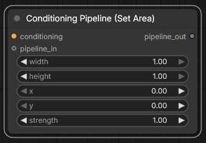
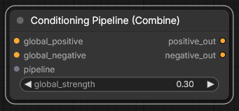
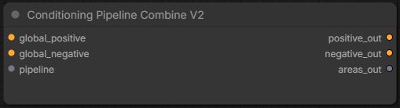
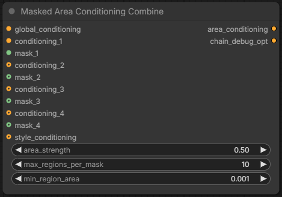
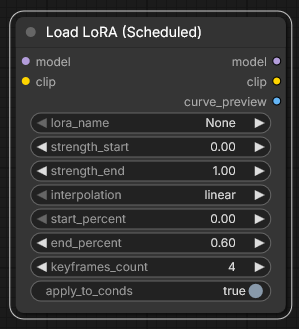
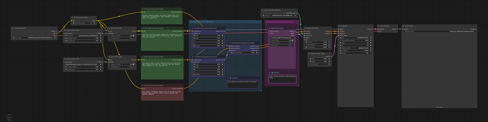
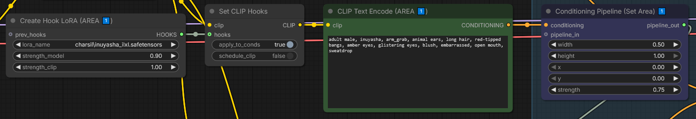
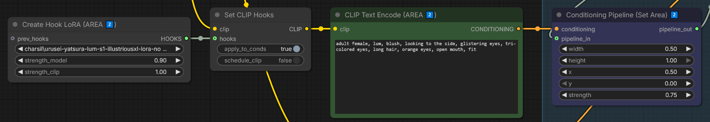
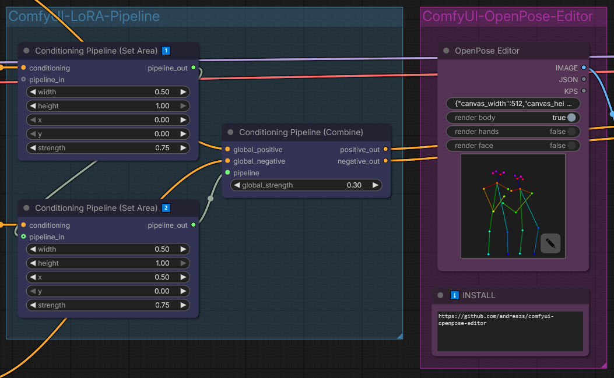

<h4 align="center">
  English | <a href="./README.de.md">Deutsch</a> | <a href="./README.es.md">Español</a> | <a href="./README.fr.md">Français</a> | <a href="./README.pt.md">Português</a> | <a href="./README.ru.md">Русский</a> | <a href="./README.ja.md">日本語</a> | <a href="./README.ko.md">한국어</a> | <a href="./README.zh.md">中文</a> | <a href="./README.zh-TW.md">繁體中文</a>
</h4>


<p align="center">
  
  
  
</p>
<br />

# ComfyUI LoRA Pipeline

Area-based LoRA conditioning wrappers and LoRA Scheduling nodes for ComfyUI.

---

## Table of Contents

- ✨ [Features](#features)
- 📦 [Installation](#installation)
- ✅ [Recommended setup (multi-area / multi-subject)](#recommended-setup-multi-area--multi-subject)
- 🔧 [Nodes](#nodes)
  - [Conditioning Pipeline (Set Area)](#conditioning-pipeline-set-area)
  - [Conditioning Pipeline (Combine)](#conditioning-pipeline-combine)
  - [Conditioning Pipeline Combine V2](#conditioning-pipeline-combine-v2)
  - [Masked Area Conditioning Combine](#masked-area-conditioning-combine)
  - [ScheduledLoRALoader](#scheduledloraloader)
- 🧩 [Optional Dependencies](#optional-dependencies)
- 🧭 [Multi-area example workflow](#example-workflow-multi-area-conditioning-pipeline)
- 🖼️ [Gallery](#gallery)
- 💙 [Funding & Support](#funding--support)
- 📄 [License](#license)
- 🚀 [Changelog](../CHANGELOG.md)

---

## Features

- Area-based conditioning pipeline for multi-subject and multi-region prompts.
- A V2 combine path that keeps full global prompt context in every region without a configurable global-strength input.
- Mask-driven regional conditioning for workflows that already provide subject or zone masks.
- One-node scheduled LoRA strength control with a curve preview output.
- For consistent multi-subject composition across multiple areas, **ControlNet + OpenPose is strongly recommended** via [comfyui-openpose-studio](https://github.com/andreszs/comfyui-openpose-studio).
- Without ControlNet/OpenPose, multi-subject multi-area composition is often inconsistent and may require many retries.
- Python-only: no JavaScript or frontend dependencies required.

---

## Installation

### Requirements
- ComfyUI (recent build)
- Python 3.10+
- Installed dependency: `scipy`
- Optional per-node dependency: `matplotlib`

### Steps

1. Clone this repository into `ComfyUI/custom_nodes/`.
2. Restart ComfyUI.
3. Confirm nodes appear under `LoRA Pipeline/`.

---

## Recommended setup (multi-area / multi-subject)

- Use ControlNet OpenPose (recommended): [comfyui-openpose-studio](https://github.com/andreszs/comfyui-openpose-studio).
- Keep the global prompt minimal and general.
- Keep `global_strength` low (rule of thumb: below `0.5`).
- Balance per-area strength, `global_strength`, and LoRA strength; do not max all strengths.
- Example baseline values that worked well: area strengths around `0.75`, LoRA strengths around `0.90`.

---

## Nodes

### Conditioning Pipeline (Set Area)

Define one area-conditioned entry at a time. This node defines a rectangular region with width, height, x, and y, then applies a dedicated conditioning prompt and strength to that region as part of a chained conditioning pipeline.



**At a glance:**
- Use one node instance per region/subject prompt.
- Chain multiple instances to build a regional conditioning pipeline.
- Enables clean multi-subject control before final combine.

**Inputs:**
- `conditioning` (`CONDITIONING`, required)
- `width`, `height`, `x`, `y` (`FLOAT`, normalized `0.0-1.0`)
- `strength` (`FLOAT`, default `1.0`)
- `pipeline_in` (`CONDITIONING_PIPELINE`, optional)

**Outputs:**
- `pipeline_out` (`CONDITIONING_PIPELINE`)

**Behavior notes:**
- Creates a new pipeline if `pipeline_in` is not connected.
- Appends a new regional entry when `pipeline_in` is connected.
- Keeps entries ordered so you can build predictable regional stacks.
- Lower area strengths often improve overall image quality, but reduce per-area control authority.
- Balance area strength together with global_strength and the LoRA strength in Create Hook Lora.

**Common mistakes:**
- Supplying pixel coordinates instead of normalized `0.0-1.0` values.
- Setting `width`/`height` near `0` and expecting visible effect.
- Forgetting to pass the final pipeline into `Conditioning Pipeline (Combine)`.

---

### Conditioning Pipeline (Combine)

Combine global positive/negative conditioning with the area pipeline for region-aware outputs. Together with Set Area, this is the core path for multi-LoRAs and separate conditionings per subject/zone.



**At a glance:**
- Converts your regional pipeline into final positive/negative outputs.
- Keeps global prompt context while adding local regional control.

**Inputs:**
- `global_positive` (`CONDITIONING`, required)
- `global_negative` (`CONDITIONING`, required)
- `pipeline` (`CONDITIONING_PIPELINE`, required)
- `global_strength` (`FLOAT`, default `0.3`)

**Outputs:**
- `positive_out` (`CONDITIONING`)
- `negative_out` (`CONDITIONING`)
- `areas_out` (`CONDITIONING_AREAS`)

**`areas_out` details:**

`areas_out` exposes the list of configured area regions as a structured data output. Each entry contains the normalized coordinates (`x`, `y`, `width`, `height`) and `strength` that were defined in the pipeline via `Conditioning Pipeline (Set Area)`. Connect `areas_out` to [ComfyUI-OpenPose-Studio](https://github.com/andreszs/comfyui-openpose-studio) to automatically mirror your conditioning areas into the OpenPose editor — pose placement will align with the exact regions you conditioned. This output can also be consumed by any other extension or node that accepts area metadata for mask generation or region-aware downstream processing.

**Behavior notes:**
- If the pipeline is empty/invalid, outputs fall back to the global inputs and `areas_out` is an empty list.
- Applies regional entries, then a default combine pass for uncovered regions.
- `global_strength` controls how strongly global context competes with local areas.
- Pushing global_strength too high can reduce per-area conditioning influence and negatively impact image quality.
- Good results generally come from balancing global strength with per-area strength and LoRA strength rather than maximizing all values.
- The optimized conditioning path is always active. Global positive conditioning is concatenated into every regional positive conditioning so per-area LoRAs remain effective; `global_strength` scales only the appended global portion.
- `fast_mode` was removed because its disabled legacy path bypassed per-area LoRA conditioning; retaining the switch would have kept exposing a known-incorrect regional path.
- When the configured regions cover the full canvas, the node avoids a separate global positive pass. If coverage is incomplete, the global fallback is retained for correctness, so the speedup will be smaller.

**Common mistakes:**
- Feeding only one conditioning stream instead of both positive and negative.
- Overdriving `global_strength` and washing out area detail.
- Building area entries but forgetting to connect the combined outputs to your sampler path.

---

### Conditioning Pipeline Combine V2

Combine the same chained rectangular area pipeline with full-strength global positive context in every regional prompt. V2 removes the `global_strength` control and always keeps the global positive conditioning available to each region, while retaining the global negative conditioning and area metadata outputs.



**At a glance:**
- Uses the same `Conditioning Pipeline (Set Area)` chain as the original combine node.
- Concatenates the complete global positive conditioning into every valid regional conditioning.
- Keeps a dynamic global default for pixels outside the configured regions.
- Exposes the configured area list for OpenPose Studio and other region-aware nodes.

**Inputs:**
- `global_positive` (`CONDITIONING`, required)
- `global_negative` (`CONDITIONING`, required)
- `pipeline` (`CONDITIONING_PIPELINE`, required)

**Outputs:**
- `positive_out` (`CONDITIONING`)
- `negative_out` (`CONDITIONING`)
- `areas_out` (`CONDITIONING_AREAS`)

**Behavior notes:**
- If the pipeline is empty or invalid, the node returns the global positive and negative conditioning with an empty area list.
- Every regional prompt receives the full global positive context; there is no per-node global-strength adjustment.
- The global positive conditioning is also retained as the default fallback for uncovered pixels.
- Regional `strength` values from each Set Area node still control their respective masks.

**Common mistakes:**
- Expecting a `global_strength` input; V2 deliberately does not expose one.
- Omitting the global positive prompt and relying only on regional prompts.
- Forgetting to connect the final Set Area pipeline to `pipeline`.

---

### Masked Area Conditioning Combine

Build regional conditioning directly from masks instead of normalized rectangle coordinates. Use this node when another part of the workflow already produces masks for the subjects or zones that need separate prompts or LoRAs.



**At a glance:**
- Accepts up to four conditioning-and-mask pairs.
- Detects and filters connected regions inside each mask.
- Concatenates global and optional style context into every regional conditioning.
- Uses the same optimized full-canvas conditioning strategy as `Conditioning Pipeline (Combine)`.

**Inputs:**
- `global_conditioning` (`CONDITIONING`, required)
- `conditioning_1` (`CONDITIONING`, required)
- `mask_1` (`MASK`, required)
- `area_strength` (`FLOAT`, default `0.5`)
- `conditioning_2` through `conditioning_4` (`CONDITIONING`, optional)
- `mask_2` through `mask_4` (`MASK`, optional)
- `style_conditioning` (`CONDITIONING`, optional)
- `max_regions_per_mask` (`INT`, default `10`)
- `min_region_area` (`FLOAT`, default `0.001`)

**Outputs:**
- `area_conditioning` (`CONDITIONING`)
- `chain_debug_opt` (`CONDITIONING`)

**Behavior notes:**
- Each optional conditioning must have its matching mask; incomplete pairs are ignored.
- Connected components smaller than `min_region_area` are ignored. If a mask contains more components than `max_regions_per_mask`, only the largest components are retained.
- `area_strength` is applied uniformly to every accepted mask.
- If the accepted masks do not cover the full canvas, global/style conditioning is retained as the fallback for uncovered pixels.
- If no valid regions remain after filtering, both outputs return the global conditioning.

**Common mistakes:**
- Connecting an optional conditioning without its matching mask, or the reverse.
- Setting `min_region_area` high enough to filter out the intended subjects.
- Sending non-binary masks and expecting values at or below `0.5` to be included.

---

### ScheduledLoRALoader

Apply one LoRA with constant strength or a scheduled curve over diffusion progress, in one clean node.



**At a glance:**
- Replaces messy chains of multiple native LoRA/control nodes.
- Keeps timing, interpolation, and preview together.
- Cleaner graph wiring for temporal LoRA behavior.

**Inputs:**
- `model` (`MODEL`, required)
- `clip` (`CLIP`, required)
- `lora_name` (`STRING`, required)
- `strength_start`, `strength_end` (`FLOAT`)
- `interpolation` (`STRING`: `linear`, `ease_in`, `ease_out`, `ease_in_out`)
- `start_percent`, `end_percent` (`FLOAT`, `0.0-1.0`)
- `keyframes_count` (`INT`, default `4`)
- `apply_to_conds` (`BOOLEAN`, optional)

**Outputs:**
- `model` (`MODEL`)
- `clip` (`CLIP`)
- `curve_preview` (`IMAGE`)

**Behavior notes:**
- If `lora_name` is `None`, model/clip pass through and preview still renders.
- If start and end strengths match, it behaves like a constant LoRA application.
- Curve preview helps quickly verify timing before full renders.

**Common mistakes:**
- Forgetting `matplotlib` when using `curve_preview`.
- Using a schedule window that does not match sampler timing intent.
- Expecting this node to directly output `CONDITIONING`.

---

## Optional Dependencies

Install only what you need, in the same Python environment used by ComfyUI.

- `ScheduledLoRALoader` curve preview: `python -m pip install matplotlib`

---

## Multi-area example workflow

[](../workflows/conditioninig_pipeline_area_wf.png)

You can drag & drop this workflow image into ComfyUI to import/load the full graph.

#### Area 1 setup

[](../assets/conditioninig_area_1.png)

- Use native `Create Hook Lora` to load one LoRA and define the area prompt/conditioning for Area 1.
- Connect that conditioning into `Conditioning Pipeline (Set Area)` and set `width`, `height`, `x`, `y`, and `strength` for that region.

#### Area 2 setup

[](../assets/conditioninig_area_2.png)

- Repeat the exact same pattern: another `Create Hook Lora` + another `Conditioning Pipeline (Set Area)`.
- You can keep repeating this pattern for additional areas.

#### Pipeline chaining and combine

[](../assets/conditioning_combine.png)

- Chain `pipeline_out` from Area 1 into Area 2 (concatenated pipeline entries).
- Send `pipeline_out` from the last area into `Conditioning Pipeline (Combine)`, which merges the area pipeline with global conditioning.
- Route combined output into `KSampler` directly, or into `ControlNet`; in this example, it is routed into `ControlNet`.

#### OpenPose / ControlNet guidance

- OpenPose/ControlNet is optional in general, but for this specific multi-subject, multi-area composition workflow it is highly recommended for consistent composition.
- See [comfyui-openpose-studio](https://github.com/andreszs/comfyui-openpose-studio) from the same author (newer repository).

#### Global `Styler Pipeline` placement

[](../assets/styler_pipeline_node.png)

Global styling means applying `Styler Pipeline` once to the whole image, in addition to (or instead of) per-area conditioning.

- General rule: connect `Styler Pipeline` before `KSampler`.
- When using ControlNet, `Styler Pipeline` can be connected either before applying ControlNet or after applying ControlNet.
- In practice, the result is usually equivalent, so choose whichever placement is more convenient in your graph.

#### `global_strength` tradeoffs

- Increasing `global_strength` too much reduces the relative influence of per-area conditionings and can weaken LoRA/style identity per area.
- Higher global strength can also negatively impact image quality.
- Keep `global_strength` low and keep the global prompt minimal/general.
- Rule of thumb: use values below `0.5` in general (tested up to `0.5`) and avoid relying on global conditioning beyond general guidance.
- Lowering LoRA strength tends to reduce LoRA identity or character fidelity, while lowering area strength tends to reduce per-area control.
- It is not recommended to max everything, because high combined strengths can sacrifice image quality. This is especially true when mixing LoRAs from different authors, which can produce inconsistent quality.
- Rule of thumb for multi-character LoRAs: when possible, use LoRAs from the same author or similar training approach for more consistent combined results.

---

## Gallery

| Preview | Description |
|---------|-------------|
| [](../workflows/winter_spring_landscape_v2.png) | **Conditioning Pipeline V2 — Winter / Spring Landscape**<br><br>Demonstrates a single continuous landscape conditioned as winter on the left and spring on the right, without ControlNet.<br><br>Drag and drop this PNG into ComfyUI, or open it from ComfyUI, to load the complete workflow embedded in the image metadata. A standalone [workflow JSON](../workflows/winter_spring_landscape_v2.json) is also included. |
| [](../workflows/conditioninig_pipeline_area.png) | **Conditioning Pipeline V2 — Multi Areas with ControlNet OpenPose**<br><br>Demonstrates multiple vertical areas with separate character LoRAs and no LoRA bleeding, using ControlNet OpenPose.<br><br>Drag and drop this PNG into ComfyUI, or open it from ComfyUI, to load the complete V2 workflow embedded in the image metadata.<br><br>Requires [comfyui-openpose-studio](https://github.com/andreszs/comfyui-openpose-studio). |
| [](../workflows/conditioninig_pipeline_styled.png) | **Conditioning Pipeline V2 — Selective Area Styling with ControlNet**<br><br>Demonstrates selective per-area styling: Inuyasha uses the original unstyled conditioning on the left, while Styler Pipeline applies Space Opera Anime, Space Marine Armor, and Neon Blue lighting only to Ayame on the right.<br><br>Drag and drop this PNG into ComfyUI, or open it from ComfyUI, to load the complete V2 workflow embedded in the image metadata.<br><br>Requires [comfyui-openpose-studio](https://github.com/andreszs/comfyui-openpose-studio) and [comfyui-styler-pipeline](https://github.com/andreszs/comfyui-styler-pipeline).<br><br>A Styler node can be inserted only into the areas that need it, while other areas connect directly to Conditioning Pipeline Set Area. Global styling is also possible by connecting the Styler node right before ControlNet. |

See [this post](https://www.andreszsogon.com/building-a-multi-character-comfyui-workflow-with-area-conditioning-openpose-control-and-style-layering/) for a complete workflow combining multiple conditioning areas, OpenPose, ControlNet and Styler all used together.

---

## Funding & Support

### Why Your Support Matters

This plugin is developed and maintained independently, with regular use of **paid AI agents** to speed up debugging, testing, and quality-of-life improvements. If you find it useful, financial support helps keep development moving steadily.

Your contribution helps:

* Fund AI tooling for faster fixes and new features
* Cover ongoing maintenance and compatibility work across ComfyUI updates
* Prevent development slowdowns when usage limits are reached

> [!TIP]
> Not donating? A GitHub star ⭐ still helps a lot by improving visibility and helping more users

### 💙 Support This Project

<table style="width: 100%; table-layout: fixed;">
  <tr>
    <td align="center" style="width: 33.33%; padding: 20px;">
      <div>
        <h4 style="margin: 8px 0;">Ko-fi</h4>
        <a href="https://ko-fi.com/D1D716OLPM" target="_blank" rel="noopener noreferrer">
          
        </a>
        <p style="margin: 8px 0; font-size: 12px;"><a href="https://ko-fi.com/D1D716OLPM" target="_blank" rel="noopener noreferrer">Buy a Coffee</a></p>
      </div>
    </td>
    <td align="center" style="width: 33.33%; padding: 20px;">
      <div>
        <h4 style="margin: 8px 0;">PayPal</h4>
        <a href="https://www.paypal.com/ncp/payment/GEEM324PDD9NC" target="_blank" rel="noopener noreferrer">
          
        </a>
        <p style="margin: 8px 0; font-size: 12px;"><a href="https://www.paypal.com/ncp/payment/GEEM324PDD9NC" target="_blank" rel="noopener noreferrer">Open PayPal</a></p>
      </div>
    </td>
    <td align="center" style="width: 33.33%; padding: 20px;">
      <div>
        <h4 style="margin: 8px 0;">USDC (Arbitrum only)</h4>
        <a href="https://arbiscan.io/address/0xe36a336fC6cc9Daae657b4A380dA492AB9601e73" target="_blank" rel="noopener noreferrer">
          
        </a>
        <p style="margin: 8px 0; font-size: 12px;"><a href="#usdc-address">Show address</a></p>
      </div>
    </td>
  </tr>
</table>

<a id="usdc-address"></a>
<details>
  <summary>Show USDC address</summary>

```text
0xe36a336fC6cc9Daae657b4A380dA492AB9601e73
```

> [!WARNING]
> Send USDC on Arbitrum One only. Transfers sent on any other network will not arrive and may be permanently lost.
</details>

## License

MIT License - see [LICENSE](../LICENSE) for full text.

---

**Maintained by:** andreszs
**Status:** Active Development

---
