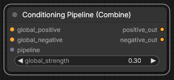
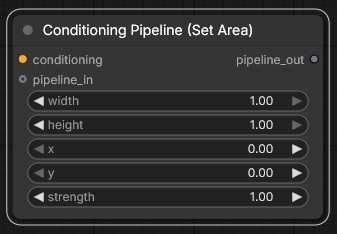
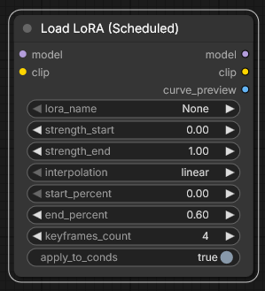
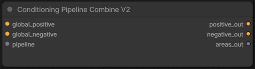
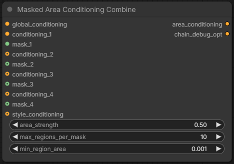
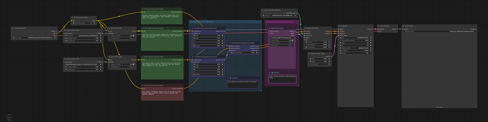
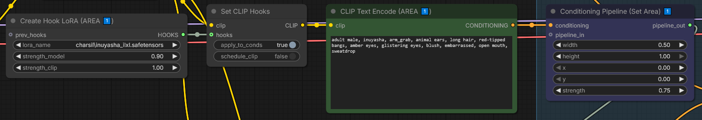
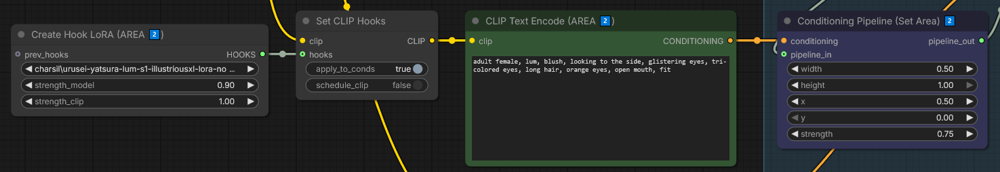
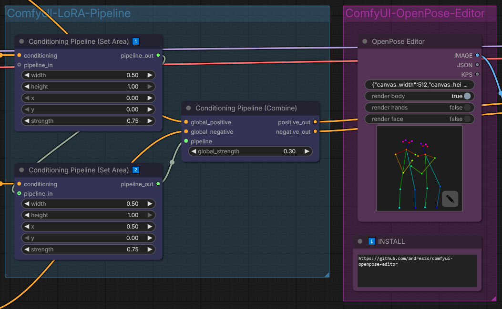

<h4 align="center">
  <a href="./README.md">English</a> | <a href="./README.de.md">Deutsch</a> | <a href="./README.es.md">Español</a> | <a href="./README.fr.md">Français</a> | Português | <a href="./README.ru.md">Русский</a> | <a href="./README.ja.md">日本語</a> | <a href="./README.ko.md">한국어</a> | <a href="./README.zh.md">中文</a> | <a href="./README.zh-TW.md">繁體中文</a>
</h4>


<p align="center">
  
  
  
</p>
<br />

# ComfyUI LoRA Pipeline

Wrappers de condicionamento LoRA baseados em área e nós de agendamento LoRA para ComfyUI.

---

## Índice

- ✨ [Recursos](#features)
- 📦 [Instalação](#installation)
- ✅ [Configuração recomendada (multiárea / multiassunto)](#recommended-setup-multi-area--multi-subject)
- 🔧 [Nós](#nodes)
  - [Conditioning Pipeline (Set Area)](#conditioning-pipeline-set-area)
  - [Conditioning Pipeline (Combine)](#conditioning-pipeline-combine)
  - [Conditioning Pipeline Combine V2](#conditioning-pipeline-combine-v2)
  - [Masked Area Conditioning Combine](#masked-area-conditioning-combine)
  - [ScheduledLoRALoader](#scheduledloraloader)
- 🧩 [Dependências opcionais](#optional-dependencies)
- 🧭 [Workflow de exemplo multiárea](#example-workflow-multi-area-conditioning-pipeline)
- 🖼️ [Galeria](#gallery)
- 💙 [Financiamento e Apoio](#funding--support)
- 📄 [Licença](#license)
- 🚀 [Registro de alterações](../CHANGELOG.md)

---

## <a id="features"></a>Características

- Pipeline de condicionamento baseado em área para prompts multissujeitos e multirregionais.
- Um caminho de combinação V2 que mantém todo o contexto do prompt global em cada região, sem uma entrada configurável de força global.
- Condicionamento regional orientado por máscaras para workflows que já fornecem máscaras de assuntos ou zonas.
- Controle de força LoRA agendado de um nó com uma saída de visualização de curva.
- Para uma composição consistente de vários assuntos em várias áreas, **ControlNet + OpenPose é fortemente recomendado** via [comfyui-openpose-studio](https://github.com/andreszs/comfyui-openpose-studio).
- Sem ControlNet/OpenPose, a composição de vários assuntos e áreas múltiplas costuma ser inconsistente e pode exigir muitas tentativas.
- Somente Python: não são necessárias dependências de JavaScript ou frontend.

---

## <a id="installation"></a>Instalação

### Requisitos
- ComfyUI (compilação recente)
- Python 3.10+
- Dependência instalada: `scipy`
- Deps opcionais por nó: `matplotlib`

### Passos

1. Clone este repositório em `ComfyUI/custom_nodes/`.
2. Reinicie ComfyUI.
3. Confirme se os nós aparecem em `LoRA Pipeline/`.

---

## <a id="recommended-setup-multi-area--multi-subject"></a>Configuração recomendada (multiárea/multiassunto)

- Use ControlNet OpenPose (recomendado): [comfyui-openpose-studio](https://github.com/andreszs/comfyui-openpose-studio).
- Mantenha o prompt global mínimo e geral.
- Mantenha `global_strength` baixo (regra geral: abaixo de `0.5`).
- Equilibre a força por área, força `global_strength` e força LoRA; não maximize todas as forças.
- Exemplos de valores de referência que funcionaram bem: intensidades de área em torno de `0.75`, intensidades de LoRA em torno de `0.90`.

---

## <a id="nodes"></a>Nós

| Conditioning Pipeline (Combine) | Conditioning Pipeline (Set Area) | Load LoRA (Scheduled) |
|---|---|---|
|  |  |  |

### <a id="conditioning-pipeline-set-area"></a>Conditioning Pipeline (Set Area)

Defina uma entrada condicionada por área por vez. Este nó define uma região retangular com largura, altura, x e y e, em seguida, aplica um prompt de condicionamento dedicado e força a essa região como parte de um pipeline de condicionamento encadeado.

**Em resumo:**
- Use uma instância de nó por prompt de região/assunto.
- Encadeie várias instâncias para construir um pipeline de condicionamento regional.
- Permite um controle limpo de vários assuntos antes da combinação final.

**Entradas:**
- `conditioning` (`CONDITIONING`, obrigatório)
- `width`, `height`, `x`, `y` (`FLOAT`, `0.0-1.0` normalizado)
- `strength` (`FLOAT`, padrão `1.0`)
- `pipeline_in` (`CONDITIONING_PIPELINE`, opcional)

**Saídas:**
- `pipeline_out` (`CONDITIONING_PIPELINE`)

**Notas de comportamento:**
- Cria um novo pipeline se `pipeline_in` não estiver conectado.
- Acrescenta uma nova entrada regional quando `pipeline_in` está conectado.
- Mantém as entradas ordenadas para que você possa criar pilhas regionais previsíveis.
- As intensidades de área mais baixas geralmente melhoram a qualidade geral da imagem, mas reduzem a autoridade de controle por área.
- Equilibre a força da área junto com global_strength e a força de LoRA em Create Hook Lora.

**Erros comuns:**
- Fornecendo coordenadas de pixel em vez de valores `0.0-1.0` normalizados.
- Definir `width`/`height` perto de `0` e esperar efeito visível.
- Esquecendo de passar o pipeline final para `Conditioning Pipeline (Combine)`.

---

### <a id="conditioning-pipeline-combine"></a>Conditioning Pipeline (Combine)

Combine o condicionamento positivo/negativo global com o pipeline de área para resultados conscientes da região. Juntamente com Set Area, este é o caminho principal para multi-LoRAs e condicionamentos separados por assunto/zona.

**Em resumo:**
- Converte seu pipeline regional em resultados finais positivos/negativos.
- Mantém o contexto de prompt global enquanto adiciona controle regional local.

**Entradas:**
- `global_positive` (`CONDITIONING`, obrigatório)
- `global_negative` (`CONDITIONING`, obrigatório)
- `pipeline` (`CONDITIONING_PIPELINE`, obrigatório)
- `global_strength` (`FLOAT`, padrão `0.3`)

**Saídas:**
- `positive_out` (`CONDITIONING`)
- `negative_out` (`CONDITIONING`)
- `areas_out` (`CONDITIONING_AREAS`)

**Detalhes sobre `areas_out`:**

`areas_out` expõe a lista de regiões de área configuradas como uma saída de dados estruturada. Cada entrada contém as coordenadas normalizadas (`x`, `y`, `width`, `height`) e `strength` definidas no pipeline via `Conditioning Pipeline (Set Area)`. Conecte `areas_out` ao [ComfyUI-OpenPose-Studio](https://github.com/andreszs/comfyui-openpose-studio) para espelhar automaticamente suas áreas de condicionamento no editor OpenPose — o posicionamento das poses se alinhará com as regiões exatas que você condicionou. Esta saída também pode ser consumida por qualquer outra extensão ou nó que aceite metadados de área para geração de máscaras ou processamento posterior com reconhecimento de região.

**Notas de comportamento:**
- Se o pipeline estiver vazio/inválido, as saídas voltam para as entradas globais e `areas_out` é uma lista vazia.
- Aplica entradas regionais e, em seguida, um passe combinado padrão para regiões descobertas.
- `global_strength` controla a intensidade com que o contexto global compete com as áreas locais.
- Pressionar global_strength muito alto pode reduzir a influência do condicionamento por área e impactar negativamente a qualidade da imagem.
- Bons resultados geralmente vêm do equilíbrio da força global com a força por área e da força LoRA, em vez de maximizar todos os valores.
- O caminho de condicionamento otimizado está sempre ativo. O condicionamento positivo global é concatenado em cada condicionamento positivo regional para que os LoRAs por área continuem eficazes; `global_strength` dimensiona apenas a parte global adicionada.
- `fast_mode` foi removido porque seu caminho legado desativado ignorava o condicionamento LoRA por área; manter o seletor continuaria expondo um caminho regional reconhecidamente incorreto.
- Quando as regiões configuradas cobrem todo o canvas, o nó evita um passe positivo global separado. Se a cobertura estiver incompleta, o fallback global é mantido por correção e o ganho de velocidade será menor.

**Erros comuns:**
- Alimentando apenas um fluxo de condicionamento em vez de positivo e negativo.
- Forçar `global_strength` em excesso e perder detalhes da área.
- Construindo entradas de área, mas esquecendo de conectar as saídas combinadas ao caminho do amostrador.

---

### <a id="conditioning-pipeline-combine-v2"></a>Conditioning Pipeline Combine V2

Combina o mesmo pipeline encadeado de áreas retangulares com o contexto positivo global em força total em cada prompt regional. V2 remove o controle `global_strength` e mantém o condicionamento positivo global sempre disponível em cada região, preservando o condicionamento negativo global e a saída de metadados das áreas.



**Visão geral:**
- Usa a mesma cadeia `Conditioning Pipeline (Set Area)` do nó Combine original.
- Concatena todo o condicionamento positivo global em cada condicionamento regional válido.
- Mantém um padrão global dinâmico para pixels fora das regiões configuradas.
- Expõe a lista de áreas configuradas para OpenPose Studio e outros nós conscientes de regiões.

**Entradas:**
- `global_positive` (`CONDITIONING`, obrigatório)
- `global_negative` (`CONDITIONING`, obrigatório)
- `pipeline` (`CONDITIONING_PIPELINE`, obrigatório)

**Saídas:**
- `positive_out` (`CONDITIONING`)
- `negative_out` (`CONDITIONING`)
- `areas_out` (`CONDITIONING_AREAS`)

**Notas de comportamento:**
- Se o pipeline estiver vazio ou inválido, o nó retorna os condicionamentos positivo e negativo globais com uma lista de áreas vazia.
- Cada prompt regional recebe todo o contexto positivo global; não há ajuste de força global por nó.
- O condicionamento positivo global também permanece como fallback padrão para pixels não cobertos.
- Os valores regionais de `strength` de cada nó Set Area continuam controlando suas respectivas máscaras.

**Erros comuns:**
- Esperar uma entrada `global_strength`; V2 deliberadamente não a expõe.
- Omitir o prompt positivo global e depender apenas de prompts regionais.
- Esquecer de conectar o pipeline final do Set Area a `pipeline`.

---

### <a id="masked-area-conditioning-combine"></a>Masked Area Conditioning Combine

Cria condicionamento regional diretamente de máscaras, em vez de coordenadas retangulares normalizadas. Use este nó quando outra parte do workflow já produzir máscaras para os assuntos ou zonas que precisam de prompts ou LoRAs separados.



**Visão geral:**
- Aceita até quatro pares de condicionamento e máscara.
- Detecta e filtra regiões conectadas dentro de cada máscara.
- Concatena contexto global e de estilo opcional em cada condicionamento regional.
- Usa a mesma estratégia otimizada de condicionamento de canvas completo de `Conditioning Pipeline (Combine)`.

**Entradas:**
- `global_conditioning` (`CONDITIONING`, obrigatório)
- `conditioning_1` (`CONDITIONING`, obrigatório)
- `mask_1` (`MASK`, obrigatório)
- `area_strength` (`FLOAT`, padrão `0.5`)
- `conditioning_2` a `conditioning_4` (`CONDITIONING`, opcional)
- `mask_2` a `mask_4` (`MASK`, opcional)
- `style_conditioning` (`CONDITIONING`, opcional)
- `max_regions_per_mask` (`INT`, padrão `10`)
- `min_region_area` (`FLOAT`, padrão `0.001`)

**Saídas:**
- `area_conditioning` (`CONDITIONING`)
- `chain_debug_opt` (`CONDITIONING`)

**Notas de comportamento:**
- Cada condicionamento opcional deve ter sua máscara correspondente; pares incompletos são ignorados.
- Componentes conectados menores que `min_region_area` são ignorados. Se uma máscara contiver mais componentes que `max_regions_per_mask`, apenas os maiores serão mantidos.
- `area_strength` é aplicado uniformemente a cada máscara aceita.
- Se as máscaras aceitas não cobrirem todo o canvas, o condicionamento global/de estilo permanece como fallback para pixels não cobertos.
- Se nenhuma região válida restar após a filtragem, ambas as saídas retornam o condicionamento global.

**Erros comuns:**
- Conectar um condicionamento opcional sem sua máscara correspondente, ou vice-versa.
- Definir `min_region_area` alto o bastante para filtrar os assuntos desejados.
- Enviar máscaras não binárias esperando que valores iguais ou inferiores a `0.5` sejam incluídos.

---

### <a id="scheduledloraloader"></a>ScheduledLoRALoader

Aplique um LoRA com força constante ou uma curva programada sobre o progresso da difusão, em um nó limpo.

**Em resumo:**
- Substitui cadeias confusas de vários nós nativos LoRA/controle.
- Mantém o tempo, a interpolação e a visualização juntos.
- Fiação de gráfico mais limpa para comportamento LoRA temporal.

**Entradas:**
- `model` (`MODEL`, obrigatório)
- `clip` (`CLIP`, obrigatório)
- `lora_name` (`STRING`, obrigatório)
- `strength_start`, `strength_end` (`FLOAT`)
- `interpolation` (`STRING`: `linear`, `ease_in`, `ease_out`, `ease_in_out`)
- `start_percent`, `end_percent` (`FLOAT`, `0.0-1.0`)
- `keyframes_count` (`INT`, padrão `4`)
- `apply_to_conds` (`BOOLEAN`, opcional)

**Saídas:**
- `model` (`MODEL`)
- `clip` (`CLIP`)
- `curve_preview` (`IMAGE`)

**Notas de comportamento:**
- Se `lora_name` for `None`, o modelo/clip passa e a visualização ainda é renderizada.
- Se as forças inicial e final corresponderem, ele se comporta como um aplicativo LoRA constante.
- A visualização da curva ajuda a verificar rapidamente o tempo antes da renderização completa.

**Erros comuns:**
- Esquecendo `matplotlib` ao usar `curve_preview`.
- Usando uma janela de agendamento que não corresponde à intenção de tempo do amostrador.
- Esperando que este nó produza diretamente `CONDITIONING`.

---

## <a id="optional-dependencies"></a>Dependências opcionais

Instale apenas o que você precisa, no mesmo ambiente Python usado por ComfyUI.

- `ScheduledLoRALoader` visualização da curva: `python -m pip install matplotlib`

---

## <a id="example-workflow-multi-area-conditioning-pipeline"></a>Workflow de exemplo multiárea

[](../workflows/conditioninig_pipeline_area_wf.png)

Você pode arrastar e soltar esta imagem de fluxo de trabalho em ComfyUI para importar/carregar o gráfico completo.

#### Configuração da área 1

[](../assets/conditioninig_area_1.png)

- Use `Create Hook Lora` nativo para carregar um LoRA e definir o prompt/condicionamento da área para a Área 1.
- Conecte esse condicionamento em `Conditioning Pipeline (Set Area)` e defina `width`, `height`, `x`, `y` e `strength` para essa região.

#### Configuração da área 2

[](../assets/conditioninig_area_2.png)

- Repita exatamente o mesmo padrão: outro `Create Hook Lora` + outro `Conditioning Pipeline (Set Area)`.
- Você pode continuar repetindo esse padrão para áreas adicionais.

#### Encadeamento de pipeline e combinação

[](../assets/conditioning_combine.png)

- Encadeie `pipeline_out` da Área 1 para a Área 2 (entradas de pipeline concatenadas).
- Envie `pipeline_out` da última área para `Conditioning Pipeline (Combine)`, que mescla o pipeline da área com o condicionamento global.
- Roteie a saída combinada para `KSampler` diretamente ou para `ControlNet`; neste exemplo, ele é roteado para `ControlNet`.

#### Orientação OpenPose / ControlNet

- OpenPose/ControlNet é opcional em geral, mas para este fluxo de trabalho específico de composição multiassunto e multiárea é altamente recomendado para uma composição consistente.
- Consulte [comfyui-openpose-studio](https://github.com/andreszs/comfyui-openpose-studio) do mesmo autor (repositório mais recente).

#### Posicionamento global do `Styler Pipeline`

[](../assets/styler_pipeline_node.png)

Estilo global significa aplicar `Styler Pipeline` uma vez a toda a imagem, além de (ou em vez de) condicionamento por área.

- Regra geral: conecte `Styler Pipeline` antes de `KSampler`.
- Ao usar ControlNet, `Styler Pipeline` pode ser conectado antes de aplicar ControlNet ou depois de aplicar ControlNet.
- Na prática, o resultado geralmente é equivalente, então escolha o posicionamento que for mais conveniente em seu gráfico.

#### `global_strength` compensações

- Aumentar muito `global_strength` reduz a influência relativa dos condicionamentos por área e pode enfraquecer a identidade de LoRA/estilo por área.
- Uma maior força global também pode impactar negativamente a qualidade da imagem.
- Mantenha `global_strength` baixo e mantenha o prompt global mínimo/geral.
- Regra prática: use valores abaixo de `0.5` em geral (testados até `0.5`) e evite confiar no condicionamento global além da orientação geral.
- Reduzir a força de LoRA tende a reduzir a identidade de LoRA ou a fidelidade do personagem, enquanto diminuir a força da área tende a reduzir o controle por área.
- Não é recomendado maximizar tudo, porque altas forças combinadas podem sacrificar a qualidade da imagem. Isto é especialmente verdadeiro ao misturar LoRAs de autores diferentes, o que pode produzir qualidade inconsistente.
- Regra geral para LoRAs com vários caracteres: quando possível, use LoRAs do mesmo autor ou abordagem de treinamento semelhante para obter resultados combinados mais consistentes.

---

## <a id="gallery"></a>Galeria

| Visualização | Descrição |
|---------|-------------|
| [](../workflows/winter_spring_landscape_v2.png) | **Conditioning Pipeline V2 — Paisagem inverno/primavera**<br><br>Demonstra uma única paisagem contínua condicionada como inverno à esquerda e primavera à direita, sem ControlNet.<br><br>Arraste este PNG para o ComfyUI, ou abra-o no ComfyUI, para carregar o workflow completo incorporado nos metadados da imagem. Um [workflow JSON independente](../workflows/winter_spring_landscape_v2.json) também está incluído. |
| [](../workflows/conditioninig_pipeline_area.png) | **Conditioning Pipeline V2 — Multiáreas com ControlNet OpenPose**<br><br>Demonstra múltiplas áreas verticais com LoRAs de personagens separados e sem sangramento de LoRA, usando ControlNet OpenPose.<br><br>Arraste este PNG para o ComfyUI, ou abra-o no ComfyUI, para carregar o workflow V2 completo incorporado nos metadados da imagem.<br><br>Requer [comfyui-openpose-studio](https://github.com/andreszs/comfyui-openpose-studio). |
| [](../workflows/conditioninig_pipeline_styled.png) | **Conditioning Pipeline V2 — Estilo seletivo por área com ControlNet**<br><br>Demonstra estilo seletivo por área: Inuyasha usa o condicionamento original sem estilo à esquerda, enquanto Styler Pipeline aplica Space Opera Anime, Space Marine Armor e iluminação Neon Blue somente a Ayame à direita.<br><br>Arraste este PNG para o ComfyUI, ou abra-o no ComfyUI, para carregar o workflow V2 completo incorporado nos metadados da imagem.<br><br>Requer [comfyui-openpose-studio](https://github.com/andreszs/comfyui-openpose-studio) e [comfyui-styler-pipeline](https://github.com/andreszs/comfyui-styler-pipeline).<br><br>Um nó Styler pode ser inserido somente nas áreas que precisam dele, enquanto as demais se conectam diretamente a Conditioning Pipeline Set Area. O estilo global também é possível conectando o nó Styler logo antes de ControlNet. |

Veja [este post](https://www.andreszsogon.com/building-a-multi-character-comfyui-workflow-with-area-conditioning-openpose-control-and-style-layering/) para um workflow completo combinando múltiplas áreas de conditioning, OpenPose, ControlNet e Styler usados ao mesmo tempo.

---

## <a id="funding--support"></a>Financiamento e Apoio

### Por que seu apoio é importante

Este plug-in é desenvolvido e mantido de forma independente, com uso regular de **agentes de IA pagos** para acelerar a depuração, testes e melhorias na qualidade de vida. Se você achar útil, o apoio financeiro ajudará a manter o desenvolvimento em andamento constante.

Sua contribuição ajuda:

* Financie ferramentas de IA para soluções mais rápidas e novos recursos
* Cubra o trabalho contínuo de manutenção e compatibilidade em ComfyUI atualizações
* Evite lentidão no desenvolvimento quando os limites de uso forem atingidos

> [!TIP]
> Não está doando? Uma estrela do GitHub ⭐ ainda ajuda muito melhorando a visibilidade e ajudando mais usuários

### 💙 Apoie este projeto

<table style="width: 100%; table-layout: fixed;">
  <tr>
    <td align="center" style="width: 33.33%; padding: 20px;">
      <div>
        <h4 style="margin: 8px 0;">Ko-fi</h4>
        <a href="https://ko-fi.com/D1D716OLPM" target="_blank" rel="noopener noreferrer">
          
        </a>
        <p style="margin: 8px 0; font-size: 12px;"><a href="https://ko-fi.com/D1D716OLPM" target="_blank" rel="noopener noreferrer">Compre um café</a></p>
      </div>
    </td>
    <td align="center" style="width: 33.33%; padding: 20px;">
      <div>
        <h4 style="margin: 8px 0;">PayPal</h4>
        <a href="https://www.paypal.com/ncp/payment/GEEM324PDD9NC" target="_blank" rel="noopener noreferrer">
          
        </a>
        <p style="margin: 8px 0; font-size: 12px;"><a href="https://www.paypal.com/ncp/payment/GEEM324PDD9NC" target="_blank" rel="noopener noreferrer">Abrir PayPal</a></p>
      </div>
    </td>
    <td align="center" style="width: 33.33%; padding: 20px;">
      <div>
        <h4 style="margin: 8px 0;">USDC (somente Arbitrum)</h4>
        <a href="https://arbiscan.io/address/0xe36a336fC6cc9Daae657b4A380dA492AB9601e73" target="_blank" rel="noopener noreferrer">
          
        </a>
        <p style="margin: 8px 0; font-size: 12px;"><a href="#usdc-address">Mostrar endereço</a></p>
      </div>
    </td>
  </tr>
</table>

<a id="usdc-address"></a>
<details>
  <summary>Mostrar endereço USDC</summary>

```text
0xe36a336fC6cc9Daae657b4A380dA492AB9601e73
```

> [!WARNING]
> Envie USDC somente no Arbitrum One. As transferências enviadas em qualquer outra rede não chegarão e poderão ser perdidas permanentemente.
</details>

## <a id="license"></a>Licença

Licença MIT - consulte [LICENSE](../LICENSE) para obter o texto completo.

---

**Mantido por:** andreszs
**Status:** Desenvolvimento Ativo

---
